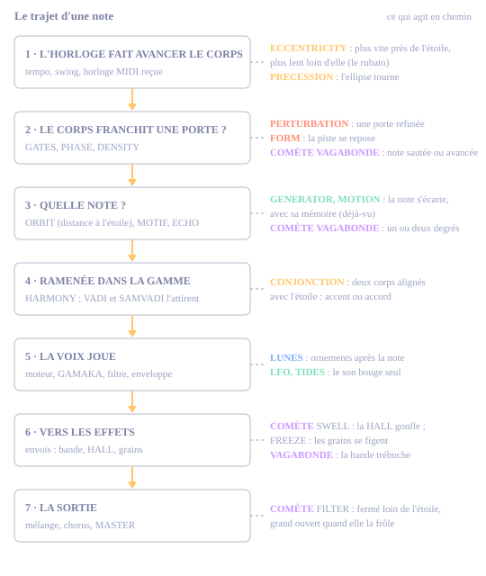
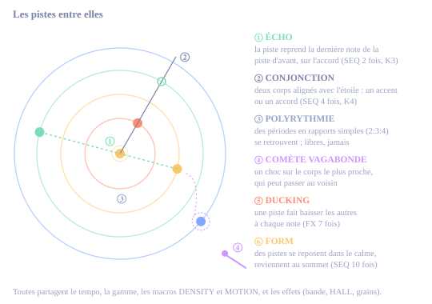

# Rhizome : mode d'emploi

Rhizome est un firmware pour le M-VAVE FM-1, écrit pour le projet ambient **When Day Chokes The Night**. Il fait l'espace et le temps :
- un **séquenceur orbital** : des corps tournent autour d'une étoile et jouent quand ils passent leurs portes. C'est la vraie mécanique de Kepler : une orbite ronde joue un rythme régulier, une orbite ovale le même rythme avec du rubato ;
- **quatorze voix de synthèse**, des cloches FM aux chœurs et aux résonateurs, dont deux faites pour les nappes : **SIX-OP FM**, qui rejoue les sons des synthés DX7 de Yamaha, et **STRING MACHINE**, les cordes électroniques des années 70 ;
- une **bande** à trois têtes, avec ses bobines à l'écran ;
- une **réverbe HALL**, dans l'esprit des grandes réverbes numériques des années 80 ;
- un **nuage de grains**, qui relit en petits morceaux ce que les pistes lui envoient.

Il joue très bien seul, et il est le compagnon de Monades, l'autre FM-1 du projet, qui fait les notes et le rythme. Sur le FM-1, ses 30 Mondes restent entre 60 et 77 % du processeur au plus fort, sans aucun décrochage.

## Premiers pas

### Écouter un Monde
1. Allumer. Un écran de démarrage montre le système du premier Monde : ses corps tombent de loin sur leurs orbites. N'importe quel bouton le ferme.
2. Sur **LIVE MONDE** (HOME), tourner **PRESET** pour choisir un Monde. L'écran affiche par exemple « MONDE 5 NIGHT » : son numéro et sa famille.
3. **PLAY** lance la musique, un nouvel appui l'arrête.
4. Tourner **K1 à K4**, les quatre macros : DENSITY (plus ou moins de notes), MOTION (des notes qui s'écartent), COLOUR (plus clair ou plus sombre), SPACE (le nuage de grains).
5. **SELECT** choisit une des six pistes ; le clavier la joue.

Maintenir n'importe quel bouton affiche son aide à l'écran, sans faire son action.

### Faire tourner ses propres orbites
1. Aller au Monde 31, **EMPTY SKY** : une page blanche, aucune porte, aucune note.
2. Appuyer sur **SEQ** : la page **ORBIT** s'ouvre. Tourner **K3 GATES** : la piste choisie devient un corps qui tourne autour de l'étoile, avec autant de portes que le réglage.
3. Avec SELECT, passer à une autre piste et lui donner aussi des portes, avec une autre durée de tour (**K1 PERIOD**).
4. Appuyer sur **PLAY**. Tous les corps partent du haut, ensemble.
5. Ovaliser une orbite avec **K2 ECCENTRICITY** : le corps accélère près de l'étoile et ralentit loin d'elle. On entend un rubato qui revient à chaque tour.

Plus rapide encore : **SEQ 2 fois**, puis **K4 SYSTEM**, pour charger un vrai système planétaire. Il se charge sur tout le Monde d'un coup : ses corps prennent les pistes qui jouent (voir [les systèmes réels](#orbit-system-seq-2-fois)). Et pour construire une séquence entière, étape par étape : [Programmer une séquence complète](#programmer-une-séquence-complète).

## Où trouver quoi

Les boutons du FM-1 portent les noms du firmware d'origine de M-VAVE, qui ne sont pas toujours ceux de Rhizome. Cinq boutons ouvrent les pages : **HOME, EDIT, SEQ, FX, GLO**. Appuyer plusieurs fois sur le même bouton fait défiler ses pages ; depuis une autre page, il ouvre sa première page. Sur chaque page, les potards K1 à K4 règlent les quatre cadres du bas de l'écran.

| Je cherche | Appuyer sur | Page |
|---|---|---|
| Les orbites d'une piste | SEQ 1 fois | ORBIT |
| La précession, la perturbation, la source des notes, un système réel | SEQ 2 fois | ORBIT / SYSTEM |
| Les lunes (ornements) | SEQ 3 fois | ORBIT / MOONS |
| La comète, les conjonctions | SEQ 4 fois | ORBIT / COMET |
| Le rythme d'une piste sans orbite | SEQ 5 fois | RHYTHM |
| Les notes écrites pas à pas, les générateurs, la forme | SEQ 7 à 10 fois | BASS / MOTIFS, PHRASE, GENERATOR, FORM |
| Le son d'une piste | EDIT 1 fois, ou tourner ALGO | SOUND |
| Le filtre, l'enveloppe | EDIT 2 et 3 fois | VELVET FILTER, ENVELOPE |
| Le volume et les envois d'une piste | EDIT 5 fois | GLOBAL MIXER |
| Le delay à bande | FX 1 et 2 fois | TAPE ECHO, TAPE ECHO / AGE |
| La réverbe | FX 3 et 4 fois | HALL, HALL / COLOR |
| Les grains | FX 5 à 7 fois | GRANULAR BUS, GRAIN CLOUD, TAPE / MOTION |
| Le retour commun de la bande et de la HALL | FX 8 fois, K4 | SHARED SPACE |
| Le chorus, l'écho calé sur le tempo | FX 10 fois | ECHO SYNC / CHORUS |
| Les LFO | FX 12 et 13 fois | LFO A, LFO B |
| Le tempo, la gamme, la note de base | GLO 1 fois | HARMONY / GLOBAL |
| Les ornements de raga | GLO 2 fois | RAGA / GAMAKA |
| ECO ou FULL, la charge du processeur | GLO 3 fois | QUALITY / SYSTEM |
| Le MIDI | GLO 5 à 7 fois | MIDI, MIDI CHANNELS, MIDI OUT ZONES |
| Mes sauvegardes | GLO 8 fois | USER BANKS |
| Passer d'un Monde à l'autre en douceur, laisser un Monde vivre seul | HOME 2 et 3 fois | MORPH, DERIVE |
| Figer la mémoire des grains | le bouton LFO | |
| Annuler | le bouton ENV | |

## Les boutons et les commandes

### Les pages, bouton par bouton

| Bouton | Pages, dans l'ordre |
|---|---|
| HOME | LIVE MONDE → MORPH → DERIVE |
| EDIT | SOUND → VELVET FILTER → ENVELOPE / BLOOM → MIX / NOTES → GLOBAL MIXER |
| SEQ | ORBIT → ORBIT / SYSTEM → ORBIT / MOONS → ORBIT / COMET → RHYTHM → GROOVE / REPEATS → BASS / MOTIFS → PHRASE / NOTES → GENERATOR / DEJA VU → FORM |
| FX | TAPE ECHO → TAPE ECHO / AGE → HALL → HALL / COLOR → GRANULAR BUS → GRAIN CLOUD → TAPE / MOTION → SHARED SPACE → SPACE TONE → ECHO SYNC / CHORUS → MARBLES / TIDES / WARPS → LFO A → LFO B |
| GLO | HARMONY / GLOBAL → RAGA / GAMAKA → QUALITY / SYSTEM → LOOK / STARTUP → MIDI / PERFORMANCE → MIDI CHANNELS → MIDI OUT ZONES → USER BANKS |

### K1 à K4, page par page
L'aide-mémoire de toutes les pages : ce que règlent les quatre potards. Le détail de chaque page est plus bas.

| Page | K1 · K2 · K3 · K4 |
|---|---|
| LIVE MONDE | DENSITY · MOTION · COLOUR · SPACE (les quatre macros) |
| MORPH | le Monde B · la position de A vers B · le passage automatique · ce qui change |
| DERIVE | la distance de la maison · la durée d'un glissement · le voyage · ce qui dérive |
| SOUND | TONE (BRIGHT) · HARMONICS (SOUND, CHORD) · SHAPE (DECAY, EXCITER, ENVELOPE, REGISTER) · LEVEL |
| VELVET FILTER | CUTOFF · RESONANCE · CHARACTER (le mode) · BREATHE |
| ENVELOPE / BLOOM | ATTACK · DECAY · LEVEL · SEND (grains) |
| MIX / NOTES | SEND (grains) · MIDI NOTE (note de base) · PAN · CLOCK DIV |
| GLOBAL MIXER | LEVEL · GRAIN · DELAY (bande) · REVERB (HALL), pour la piste choisie |
| ORBIT | PERIOD · ECCENTRICITY · GATES · PHASE |
| ORBIT / SYSTEM | PRECESSION · PERTURBATION · PITCH (source des notes) · SYSTEM |
| ORBIT / MOONS | MOONS · SPIN · INTERVAL · LEVEL |
| ORBIT / COMET | COMET · EVENT · AMOUNT · CONJUNCTION |
| RHYTHM | HITS · LENGTH · ROTATION · CHANCE |
| GROOVE / REPEATS | SWING · REPEATS · ACCENT · CLOCK DIV |
| BASS / MOTIFS | PHRASE (OFF, EUCLID, STEP) · MOTIF · GLIDE · BASE NOTE |
| PHRASE / NOTES | STEP · NOTE / REST · ACCENT · CHANCE |
| GENERATOR / DEJA VU | SOURCE · DEJA VU · LOOP · SPREAD |
| FORM | DEPTH · SECTION · RESTING · MOTION |
| TAPE ECHO | TIME · FEEDBACK · HEADS · WOW |
| TAPE ECHO / AGE | DRIVE · AGE · TONE · TRANSPORT |
| HALL | DECAY · SIZE · PRE-DELAY · MOD |
| HALL / COLOR | BASS · TREBLE · DIFFUSION · VINTAGE |
| GRANULAR BUS | SPACE · GRAIN SIZE · POSITION · FEEDBACK |
| GRAIN CLOUD | DENSITY · SHAPE · RANDOM · MEDIA |
| TAPE / MOTION | PITCH (des grains) · DIRECTION · DUCK FROM · DUCK % |
| SHARED SPACE | ECHO (temps de la bande) · FEEDBACK · ROOM TAIL (longueur de la HALL) · RETURN |
| SPACE TONE | SEND HIGH-PASS · ECHO TONE · ROOM TONE · DIFFUSION |
| ECHO SYNC / CHORUS | ECHO SYNC · FEEDBACK · CHORUS MIX · CHORUS DEPTH |
| MARBLES / TIDES / WARPS | MARBLES · TIDES · CYCLE · WARPS |
| LFO A, LFO B | RATE · SHAPE · TARGET · DEPTH |
| HARMONY / GLOBAL | ROOT · SCALE · TRANSPOSE · TEMPO |
| RAGA / GAMAKA | VADI · SAMVADI · GAMAKA · AMOUNT |
| QUALITY / SYSTEM | le tempo · ECO ou FULL · la remontée du ducking · le pic mesuré à zéro |
| LOOK / STARTUP | MOTION (animations) · START SOUND · INTRO · CPU MAX |
| MIDI / PERFORMANCE | CLOCK IN · SCALE SNAP · NOTES OUT · CLOCK OUT |
| MIDI CHANNELS | la piste · son canal d'entrée · son canal de sortie · ALL FROM |
| MIDI OUT ZONES | la zone · sa note basse · sa note haute · son canal |
| USER BANKS | l'emplacement · MONDES ou SOUNDS · LOAD · le curseur du nom |

### Les autres commandes

| Commande | Ce qu'elle fait |
|---|---|
| **SELECT** (encodeur) | Choisit la piste, 1 à 6. Les pages d'une piste et le clavier la suivent. |
| **SEL** | Coupe ou rétablit la piste choisie. Allumé quand elle est coupée. |
| **ALGO** (encodeur) | Change le moteur de la piste choisie (14 moteurs) et ouvre SOUND. |
| **PRESET** (encodeur) | Sur les pages d'une piste : un des 256 sons. Ailleurs : un des 30 Mondes, ou EMPTY SKY. Sur MORPH : le Monde d'arrivée. Sur USER BANKS : la lettre du nom. Le bas de l'écran dit ce que fait PRESET. |
| **PLAY** | Lance ou arrête. L'arrêt laisse le son s'éteindre ; un nouveau départ fait repartir tous les corps du haut. |
| **REC** | N'enregistre rien. Sur LIVE, les pages GLO (sauf RAGA / GAMAKA) et les pages du séquenceur orbital et des effets (les quatre pages ORBIT, TAPE ECHO, HALL et GRAIN CLOUD) : une nouvelle variation (nouvelle graine). Sur les autres pages EDIT, SEQ et FX, et sur RAGA / GAMAKA : **DICE**, les réglages K1 à K4 de la page tirés au sort. Sur GENERATOR : efface le motif. Sur QUALITY / SYSTEM et MIDI : panique (tout se tait). Sur MORPH : garde le mélange. Sur DERIVE : l'état actuel devient la maison. |
| **ENV** | Annule : revient à l'état d'avant la dernière variation ou le dernier DICE. Une seule étape. Luit faiblement quand il y a quelque chose à annuler. Il ne règle pas les enveloppes. |
| **ARP** | Verrouille la graine (LOCK) : la même variation se répète, et les mêmes chocs de comète aussi. Allumé quand elle est verrouillée. |
| **LFO** | Fige la mémoire des grains (FREEZE) : les grains rejouent ce qui est enregistré, les pistes continuent. Il n'ouvre pas les LFO (FX 12 et 13 fois). |
| **SAVE** | Sauve le Monde et les préférences, puis ouvre USER BANKS. Voir [Sauvegarder](#sauvegarder-et-recharger). |
| **OCT− / OCT+** | L'octave du clavier. |
| **MASTER** (potard) | Le volume de sortie, casque et haut-parleur, et ce que l'audio USB enregistre. |
| **Clavier** | Joue la piste choisie (première touche : F3). Sur HARMONY avec la gamme CUSTOM : ajoute ou retire la note. Sur GENERATOR : écrit le motif. |

Les potards K1 à K4 avancent de 2 par cran pour les valeurs de 0 à 100.

### Les lumières

| Bouton | Allumé quand… |
|---|---|
| HOME, EDIT, SEQ, FX, GLO | Une de ses pages est affichée. |
| SEL | La piste choisie est coupée. |
| ARP | La graine est verrouillée. La plupart des Mondes démarrent verrouillés. |
| LFO | La mémoire des grains est figée. |
| PLAY | La musique joue. |
| ENV (faible) | Il y a quelque chose à annuler. |
| Touches | La touche est enfoncée, ou la piste choisie vient de jouer cette note. |

### DICE : tirer une page au sort
Sur les pages EDIT, de RHYTHM à FORM, de GRANULAR BUS à LFO B (sauf GRAIN CLOUD) et sur RAGA / GAMAKA, **REC** tire au sort les réglages K1 à K4 de la page affichée, pour la piste choisie si c'est une page de piste. L'écran affiche par exemple « DICE: LFO A T3 ». ENV annule. Ne changent jamais : la gamme, la note de base, la transposition, le tempo, les mutes, les moteurs, le MIDI et les autres pistes. Les réinjections restent loin du larsen, et un effet tiré au sort reste audible.

| Page | Ce que REC tire au sort |
|---|---|
| SOUND | TONE, HARMONICS, et SHAPE ou DECAY selon le moteur. |
| VELVET FILTER | Le mode (jamais OFF), la coupure (basse en passe-haut, au milieu en passe-bande, jamais fermée en passe-bas), la résonance, BREATHE. |
| ENVELOPE / BLOOM | L'attaque (moteurs mélodiques), le déclin, l'envoi vers les grains. |
| MIX / NOTES | L'envoi vers les grains, le panoramique, la division d'horloge (1 à 4). |
| GLOBAL MIXER | Le niveau de la piste (30 à 80), les envois vers les grains, la bande et la HALL. |
| RHYTHM | La longueur (5 à 16), le nombre de coups (au moins un), la rotation, CHANCE. |
| GROOVE / REPEATS | Le swing, les répétitions, l'accent, la division d'horloge. |
| BASS / MOTIFS | Le motif et le glide (le mode de phrase et la note de base restent). |
| PHRASE / NOTES | Les 16 notes (silences compris, le premier pas sonne), l'accent, CHANCE. |
| FORM | La profondeur, la longueur des sections, les pistes au repos, MOTION. |
| GRANULAR BUS | Le niveau des grains, leur taille, leur position, la réinjection. |
| TAPE / MOTION | La hauteur des grains (octave, quinte, quarte ou rien), le sens, et la quantité de ducking si une source est choisie. |
| SHARED SPACE | Le temps de la bande (ou sa division si elle est calée sur le tempo), la réinjection, la longueur de la HALL, le retour. |
| SPACE TONE | Le passe-haut des envois, la couleur de la bande et de la HALL, la diffusion. |
| ECHO SYNC / CHORUS | La division, la réinjection, le chorus et sa profondeur. |
| MARBLES / TIDES / WARPS | Les quatre réglages de la piste. |
| LFO A, LFO B | La vitesse, la forme, la cible (pas le filtre si la piste n'en a pas), la profondeur (faible sur la hauteur). |
| RAGA / GAMAKA | La vadi et la samvadi (des notes de la gamme), le gamaka de la piste et sa quantité. |

Sur SHARED SPACE, SPACE TONE et ECHO SYNC / CHORUS, un retour d'effets à 0 remonte, et une piste sans aucun envoi en reçoit : le tirage reste audible.

## L'accueil : LIVE MONDE, MORPH, DERIVE

### LIVE MONDE (HOME 1 fois)
À gauche, le **système orbital du Monde en miniature**, tel qu'il joue :
- l'**étoile** au centre, qui brille de ce qu'on entend ;
- l'**ellipse** de chaque piste qui a des portes, dans sa couleur, et ses **portes** en pointillé, qui s'allument en blanc quand le corps les franchit ;
- chaque **corps** là où il est, avec une onde à chaque note ; la piste choisie est cerclée ;
- un trait de l'étoile vers deux corps **en conjonction** ;
- la **comète** quand elle passe dans le cadre ;
- autour, l'**anneau de poussière**, dont la taille et l'éclat suivent **SPACE**.

À droite, les six pistes et leur moteur, avec un vumètre. En bas : le Monde, `*` s'il a été modifié, LOCK ou RAND (la graine), ICE ou REC (la mémoire des grains figée ou qui enregistre). En haut à droite : ▶ ou ■ et le tempo.

| Potard | Macro | Ce qu'elle fait |
|---|---|---|
| K1 | DENSITY | Ajoute ou retire des portes à toutes les orbites (jusqu'à cinq de chaque côté), et des coups aux pistes sans orbite. Une orbite garde sa période et sa forme. |
| K2 | MOTION | La part des notes qui s'écartent de leur note de base, dans la gamme. |
| K3 | COLOUR | Tout le son plus clair ou plus sombre. |
| K4 | SPACE | Le volume du nuage de grains. À 0, les grains se taisent et ne coûtent plus rien. |

**Au démarrage**, les corps du Monde tombent de loin sur leurs orbites, puis tournent à leurs vraies vitesses. Sur **LOOK / STARTUP** (GLO 4 fois), K1 choisit si les corps tournent (LIVING) ou restent immobiles (STILL), et K3 rejoue le démarrage.

### MORPH (HOME 2 fois) : passer d'un Monde à l'autre en douceur
Le Monde en cours (A) glisse vers un autre (B). Les nombres glissent (tempo, filtres, niveaux, envois, effets, densité, notes de base). Les choix d'une piste (moteur, mode de filtre, LFO, générateur, gamaka) basculent chacun à son moment, une piste après l'autre ; autour de ce moment, la piste descend jusqu'au silence puis remonte. La gamme, la note de base et la graine basculent à mi-chemin.

| Potard | Réglage |
|---|---|
| K1 MONDE B | Le Monde d'arrivée (aussi avec PRESET). Rien ne change tant que K2 est à 0. |
| K2 POSITION | De A (0) à B (100). |
| K3 AUTO | BY HAND, ou 4 à 64 mesures : la lecture fait le passage. |
| K4 MORPH | ALL, SOUND, RHYTHM ou EFFECTS : ce qui change ; le reste reste sur A. |

REC garde le mélange en cours, ENV revient à A.

**À l'écran** : les deux Mondes sous forme de systèmes, immobiles, tels qu'ils partent au PLAY : A s'éteint à gauche, B s'allume à droite. Entre eux, **le système qui joue**, vivant (ses corps tournent, ses notes font des ondes), voyage de A vers B avec la position. Quand aucun passage n'est en cours, le système qui joue est au centre. La barre de position porte un trait par piste, le moment où ses choix basculent ; dessous, le tempo de A, le tempo en cours et celui de B, puis les deux gammes (la claire est celle qui joue), et six carrés, un par piste : creux avant sa bascule, sombre pendant son fondu, plein après, un tiret si rien ne bascule.

**Ce qui ne glisse pas.** MORPH fait glisser les sons, les rythmes, les notes, les envois, le temps et la réinjection de la bande, la longueur de la HALL et le retour. Ces réglages-ci restent ceux de A pendant tout le passage : **les orbites** (périodes, portes, excentricités, sources des notes, lunes), **la comète**, les têtes, l'usure et le transport de la bande, la taille et la couleur de la HALL, et les réglages de GRAIN CLOUD. Pour passer aussi aux orbites de B, il faut charger B (PRESET sur LIVE). Les mutes, le verrou de graine et la qualité ne bougent pas non plus.

### DERIVE (HOME 3 fois) : laisser le Monde vivre seul
Le Monde change tout seul pendant la lecture, pendant des minutes ou des heures. Dès que K2 quitte OFF, le Monde en cours devient **la maison** : il glisse vers une variante tirée autour d'elle, puis vers la suivante. Glissent : timbres, filtres, enveloppes, panoramique, envois, accents, nombre de coups, LFO déjà actifs, grains, bande, HALL, chorus, et le tempo (±10 %). De temps en temps une piste se tait le temps d'un glissement, puis revient. Ne bougent jamais : la gamme, la note de base, la transposition, les mutes.

| Potard | Réglage |
|---|---|
| K1 DISTANCE | NEAR, MIDDLE, FAR : l'écart permis autour de la maison. |
| K2 GLIDE | OFF, ou 8 à 256 mesures par glissement. |
| K3 VOYAGE | STAY, FAMILY, ANY MONDE : un glissement sur quatre va vers un autre Monde (de la même famille, ou n'importe lequel), le suivant revient. |
| K4 DRIFT | ALL, SOUND, RHYTHM, EFFECTS : ce qui dérive. |

REC : l'état actuel devient la maison. ENV : retour à la maison. Avec ARP, la même dérive refait le même chemin. Pour une installation, K2 sur 128 ou 256 mesures.

**À l'écran** : la maison au centre, en système pâle et immobile, et le système qui joue, vivant, qui tourne autour d'elle au bout d'une laisse en pointillé, d'autant plus loin que le son s'en est éloigné. Le temps écoulé, l'avancée du glissement en cours, le temps avant le suivant (« NEXT »), et les trois derniers changements (« T3 DECAY UP », « T5 RESTS », « T5 COMES BACK », « NEW NOTES », « HOME AGAIN »…).

Comme MORPH, la dérive ne touche pas aux orbites, à la comète ni aux réglages propres à la bande, à la HALL et aux grains : le ciel du Monde reste le même, ce sont les sons, les notes et les envois qui dérivent. Un réglage tourné pendant la dérive reste, et la maison le prend aussi. Charger un Monde arrête la dérive.

## Les Mondes

Un **Monde** est une scène complète : les six pistes avec leur moteur et leur son, leurs orbites et leurs notes, les quatre macros, les effets, la gamme et le tempo. Charger un Monde remplace tout, y compris la mémoire des grains.

Rhizome a **30 Mondes**, écrits pour When Day Chokes The Night, en neuf familles. Les trois premières vont du crépuscule à l'aube, et chacune montre une idée du séquenceur orbital. DEEP fait évoluer la musique sur plusieurs minutes. ECHO met la bande et la HALL au premier plan, VOICE les deux voix faites pour les nappes, SIX-OP FM et STRING MACHINE. RAGA, MAQAM et EAST parcourent les gammes du monde : les ragas de l'Inde, les modes arabes et persans avec leurs quarts de ton, le gamelan de Java, la Thaïlande et le Japon. Le 31e, **EMPTY SKY**, est une page blanche : six pistes jouables au clavier, aucune porte, aucun coup, les effets à zéro (C MINOR, 64 BPM).

Chaque Monde joue **quatre voix au plus**, et ceux des familles ECHO, VOICE, RAGA, MAQAM et EAST trois : c'est ce qui les garde loin de la limite du processeur, la bande, la HALL et les grains en prenant déjà une bonne part. Tous sont réglés au même niveau d'écoute (NO STARS et LOOPS OF ASH, plus clairsemés, un peu plus bas).

**DUSK, les résonances.** Des orbites rondes ou presque, dont les durées de tour sont des rapports simples. On entend des polyrythmes lents et réguliers.

| Monde | Gamme · tempo | Ce qu'on entend |
|---|---|---|
| 1 LAST LIGHT | D DORIAN · 64 | Quatre corps en 8:3:4:6 : la basse fait le 8, des cloches et un sinus au-dessus. |
| 2 AMBER HOUR | A MINOR PENT · 72 | Une résonance de Laplace : 1:2:4, comme Io, Europe et Ganymède. Des cloches FM. |
| 3 LONG SHADOWS | F LYDIAN · 60 | Trois corps de cinq portes en 6:7:8 : ils se décalent lentement, puis se retrouvent. |
| 4 SLOW EMBERS | E MINOR · 54 | Tintinnabuli : une flûte joue sa phrase (MOTIF), un sinus lui répond sur l'accord (ECHO). |

**NIGHT, les orbites excentriques.** Le rubato : les corps pressent près de l'étoile et restent suspendus loin d'elle. Les ellipses tournent (précession), certaines portes sautent (perturbation).

| Monde | Gamme · tempo | Ce qu'on entend |
|---|---|---|
| 5 NIGHT SWALLOWS | C PHRYGIAN · 58 | Deux corps très excentriques, des notes qui se précipitent puis attendent. |
| 6 BLACK ORCHARD | G KUMOI · 66 | La perturbation la plus forte : des portes qui respirent et se taisent. Bande usée, grains sales. |
| 7 SLEEPLESS TIDE | D JUST MINOR · 50 | Une marée : les ellipses tournent vite, les notes montent près de l'étoile. |
| 8 NO STARS | B LOCRIAN · 46 | Presque rien. Une comète toutes les 32 mesures fige les grains. |

**DAWN, les lunes et les comètes.** Des ornements après les notes, des passages rares, des accords quand les corps s'alignent.

| Monde | Gamme · tempo | Ce qu'on entend |
|---|---|---|
| 9 FIRST BIRD | G MAJOR PENT · 76 | Des lunes qui montent la gamme et par tierces : des appels d'oiseaux. |
| 10 PALE COMET | E LYDIAN · 62 | Une comète toutes les 16 mesures : la salle gonfle à son passage. |
| 11 CHOKED DAWN | F# DORIAN · 56 | Les conjonctions frappent des accords. Bande saturée et usée, comète qui gonfle et fige. |
| 12 DAY BREAKS | D MIXOLYDIAN · 84 | Une phrase ornée d'harmoniques, des accords aux conjonctions, une comète qui fige les grains. |

**DEEP, les formes longues.** Des Mondes qui ne cessent de changer : générateurs, forme, systèmes réels, LFO lents, périodes libres.

| Monde | Gamme · tempo | Ce qu'on entend |
|---|---|---|
| 13 TRAPPIST DUST | E HIRAJOSHI · 66 | La chaîne résonante de TRAPPIST-1 (2:3:4:6), ses notes tirées par des générateurs qui s'en souviennent (déjà-vu), puis les lâchent peu à peu. |
| 14 SLOW TIDES | F MIXOLYDIAN · 58 | La forme : calme, montée, sommet, retombée, seize mesures chacun, des pistes qui se taisent et reviennent ; des LFO ouvrent les filtres et déplacent les voix. STRING MACHINE à la basse, SIX-OP FM dans les aigus. |
| 15 LOOPS OF ASH | F MINOR · 60 | Quatre périodes libres, une porte chacune, aux longueurs des boucles de bande de *Music for Airports* (Brian Eno). Quatre voix qui ne retombent jamais ensemble : la musique ne se répète jamais. |

**ECHO, la bande et la HALL.** Trois voix seulement, pour laisser toute la place aux effets.

| Monde | Gamme · tempo | Ce qu'on entend |
|---|---|---|
| 16 RUST REELS | C IWATO · 70 | La bande en avant : ses trois têtes, une bande usée, qui pleure et sature ; une cloche et une flûte jouées dedans, l'écho très présent. |
| 17 CATHEDRAL OF SMOKE | E HARMONIC MIN · 48 | La HALL en avant : la plus grande salle, une longue pré-attente, peu de notes ; toutes les 8 mesures, une comète fait gonfler la salle. |
| 18 DRIFTING SIGNAL | D HIJAZ · 62 | Les deux, comme une vieille radio : une HALL VINTAGE, une bande qui ondule, une anche qui glisse vers ses notes (meend). |

**VOICE, les nappes.** SIX-OP FM ou STRING MACHINE au premier plan, avec deux autres voix.

| Monde | Gamme · tempo | Ce qu'on entend |
|---|---|---|
| 19 GLASS PLANETS | A SLENDRO · 66 | Le son DX7 PLANETS dans un accord de gamelan ; chaque note fait tourner deux lunes qui montent la gamme. |
| 20 ASH ENSEMBLE | F MELODIC MIN · 56 | Les cordes de STRING MACHINE sur une période libre de 23,5 s, quel que soit le tempo ; des accords quand les corps s'alignent. |
| 21 NIGHT BELLS | G BHUPALI · 60 | Les cloches tubulaires du DX7 sur un chœur tenu ; une comète toutes les 32 mesures fige les grains. |

**RAGA, les ragas des heures.** En Inde, chaque raga a son heure. Trois ragas, du coucher du soleil à l'aube, avec leurs notes pivots (VADI et SAMVADI, page RAGA / GAMAKA) et leurs ornements (gamakas).

| Monde | Gamme · tempo | Ce qu'on entend |
|---|---|---|
| 22 MARWA AT SUNSET | A MARWA · 52 | Le raga du coucher du soleil : pas de quinte, la seconde bémol qui tire contre le bourdon. Une flûte glisse vers ses notes (meend) en jouant la tournure du raga, une nappe DX7 lui répond ; toutes les 16 mesures, la comète ouvre le ciel (FILTER). |
| 23 MALKAUNS MIDNIGHT | C# MALKAUNS · 46 | Le raga du cœur de la nuit, cinq notes. Une anche ondule sur elles (andolan) et improvise avec les enchaînements de la phrase (Markov) ; un chœur en période libre ; la comète vagabonde bouscule les corps. |
| 24 BHAIRAV DAWN | E BHAIRAV · 60 | Le raga de l'aube : des cloches de temple (DX7) frôlées d'une note (kan), leurs harmoniques en lunes, une anche qui répond ; des accords quand les corps s'alignent. |

**MAQAM, les modes arabes et persans.** Avec leurs quarts de ton : des notes entre les touches du piano.

| Monde | Gamme · tempo | Ce qu'on entend |
|---|---|---|
| 25 SABA LAMENT | D SABA · 54 | Le maqam de la plainte, sa seconde en quart de ton et sa quarte abaissée : un ney (flûte) qui glisse, un qanun pincé, le bourdon ; une bande usée, une HALL VINTAGE. |
| 26 BAYATI WINDS | G BAYATI · 66 | Un santour (marimba) dont un générateur tire les notes en s'en souvenant, ses lunes qui descendent le mode, une anche au-dessus ; la comète vagabonde passe de temps en temps. |
| 27 ORIENTAL GLASS | E ORIENTAL · 58 | La gamme orientale et ses deux secondes augmentées : des verres à vin DX7, une anche, des ellipses qui tournent (précession) et respirent (perturbation) dans une grande salle. |

**EAST, Java, la Thaïlande, le Japon.**

| Monde | Gamme · tempo | Ce qu'on entend |
|---|---|---|
| 28 PELOG RAIN | D PELOG · 72 | Un gamelan : deux corps de bronze qui s'imbriquent (l'un tourne deux fois plus vite que l'autre), un gong sur une longue orbite, une pluie de lunes ; toutes les 8 mesures, la comète fige les grains. |
| 29 THAI MOON | C THAI 7-TET · 70 | Les sept degrés égaux de la musique thaïe : un ranat (marimba) et un pi (anche) sur des orbites en 3:4, avec du rubato. |
| 30 INSEN SNOW | A INSEN · 50 | Le mode japonais du koto : une nappe DX7 glacée, une flûte de bambou qui glisse, deux périodes libres qui ne se rencontrent jamais ; la comète fige les grains comme de la neige. |

**Changer de Monde.** Sur LIVE, tourner PRESET. Si le Monde en cours a changé depuis qu'il a été chargé ou sauvé, une carte demande d'abord « KEEP YOUR CHANGES? » : **SEL** abandonne les changements et charge le Monde demandé, **SAVE** ouvre l'écran de sauvegarde, **HOME** garde le Monde en cours, **PRESET** en choisit un autre. La lecture continue pendant la question.

## Le séquenceur orbital

C'est la grande nouveauté de Rhizome : au lieu d'une grille de pas, des corps qui tournent autour d'une étoile. Le bouton **SEQ** ouvre ses dix pages, dans cet ordre :

| SEQ | Page | À quoi elle sert |
|---|---|---|
| 1 fois | **ORBIT** | L'orbite de la piste choisie : la durée du tour, sa forme, ses portes. |
| 2 fois | **ORBIT / SYSTEM** | Tout le système : les ellipses qui tournent, le désordre, la source des notes, les vrais systèmes planétaires. |
| 3 fois | **ORBIT / MOONS** | Les lunes de la piste choisie : les ornements après chaque note. |
| 4 fois | **ORBIT / COMET** | La comète (rare, ou vagabonde) et les alignements des corps. |
| 5 fois | **RHYTHM** | Le rythme d'une piste qui n'est pas en orbite. |
| 6 fois | **GROOVE / REPEATS** | Le swing, les répétitions, l'accent, la vitesse de la piste. |
| 7 fois | **BASS / MOTIFS** | Activer une phrase de notes écrites. |
| 8 fois | **PHRASE / NOTES** | Écrire cette phrase, pas à pas. |
| 9 fois | **GENERATOR / DEJA VU** | Des notes qui s'inventent, et leur mémoire ; le motif joué au clavier. |
| 10 fois | **FORM** | Une grande forme : calme, montée, sommet, détente. |

Les quatre premières sont celles du séquenceur orbital ; les six suivantes servent aux pistes qui ne sont pas en orbite, mais les phrases, les générateurs et la forme agissent aussi sur les corps.

### L'idée, en partant d'un séquenceur pas à pas
Un séquenceur pas à pas fait tourner une boucle de pas, et certains pas jouent. Le séquenceur orbital fait la même chose, mais la boucle est **une orbite**, et la piste est **un corps** qui en fait le tour.

| Sur un séquenceur pas à pas | Sur le séquenceur orbital |
|---|---|
| La longueur de la boucle (le nombre de pas) | **PERIOD** (K1) : la durée d'un tour, de 1 temps à 12 mesures, ou libre, en secondes |
| Les pas qui jouent | **GATES** (K3) : de 1 à 16 portes par tour, réparties le plus régulièrement possible |
| Décaler le motif | **PHASE** (K4) : faire tourner les portes |
| Le swing, le même petit retard à chaque contretemps | **ECCENTRICITY** (K2) : le tour garde sa durée, mais les notes se resserrent d'un côté de l'orbite et s'étirent de l'autre |
| Une piste, une boucle | Une piste, un corps. Plusieurs corps aux périodes différentes font une polyrythmie qui se réaligne |

Concrètement :
- **Le nombre de pas d'un tour**, c'est PERIOD. Ses 13 premières valeurs, en doubles croches : 4 (1 temps), 6, 8, 12, 16 (1 mesure), 24, 32, 48, 64, 96, 112, 128 et 192 (12 mesures).
- **Au-delà, les périodes libres** : 5,1 s, 7,3 s, 11,6 s, 17,8 s, 20,1 s, 23,5 s, 29,9 s et 31,8 s, quel que soit le tempo. Aucune ne divise une autre : deux corps libres ne retombent jamais ensemble, et la musique ne se répète pas. Les cinq dernières sont les longueurs des boucles de bande de *Music for Airports* de Brian Eno. Sur une orbite libre, les portes sont placées sur 16 directions.
- **Le nombre de notes par tour**, c'est GATES, de 1 à 16. Il ne peut pas dépasser le nombre de pas du tour : un tour d'un temps compte 4 pas, donc 4 portes au plus. À 0, la piste n'est plus un corps et reprend son rythme de la page RHYTHM.
- **Les portes sont placées comme un rythme euclidien** : réparties le plus régulièrement possible sur les pas du tour. Par exemple, 5 portes sur un tour d'une mesure (16 pas) tombent sur les pas 1, 5, 8, 11 et 14. Avec 4 portes, on obtient quatre noires.

### Les portes
Une **porte**, c'est l'endroit de l'orbite où le corps joue une note. Imaginez un cadran d'horloge autour de l'étoile : chaque porte est une heure de ce cadran, une direction vue depuis l'étoile. Le corps tourne sans jamais s'arrêter ; **chaque fois qu'il passe devant une de ses portes, la piste joue une note**. Entre deux portes, il ne joue rien.
- **Combien** : K3 **GATES** (page ORBIT), de 1 à 16 portes par tour. 4 portes sur un tour d'une mesure : quatre notes par mesure. À **0**, la piste n'a plus d'orbite (voir ci-dessous).
- **Où** : les portes sont réparties le plus régulièrement possible sur le tour, comme un rythme euclidien. K4 **PHASE** les fait tourner toutes ensemble autour de l'étoile, pour décaler le motif.
- **Plus ou moins** : la macro **DENSITY** (LIVE K1) en ajoute ou en retire à toutes les orbites, sans changer leur période.
- **À l'écran** : de petits traits sur l'ellipse. Une porte devient **blanche** quand le corps la franchit et joue, **grise** quand la perturbation l'a refusée. Sur LIVE MONDE, les portes sont en pointillé autour de chaque ellipse.

Sur une orbite ronde, le corps va à vitesse constante : les portes tombent à intervalles réguliers. Sur une orbite ovale, il passe ses portes vite près de l'étoile et lentement loin d'elle : c'est le rubato (voir plus bas).

### Orbite ou rythme : qui joue la piste ?
Chaque piste a deux façons de jouer : **son orbite** (pages ORBIT) ou **son rythme** (page RHYTHM, des coups sur une boucle de pas). **Tant que l'orbite d'une piste a au moins une porte, c'est l'orbite qui la joue**, et son rythme se tait.
- Pour la faire jouer par son rythme : **SEQ 1 fois (ORBIT), K3 GATES à 0**. Les réglages HITS, LENGTH, ROTATION et CHANCE de RHYTHM reprennent la main.
- Pour la remettre en orbite : GATES au-dessus de 0.
- Les réglages de RHYTHM restent gardés même quand l'orbite joue. Pendant la lecture, la page RHYTHM montre ce qui est vraiment joué : 0 coup quand l'orbite a la main, et l'écran l'écrit en rouge, « ORBIT PLAYS THIS TRACK: SET GATES TO 0 ».
- Dans les Mondes d'usine, presque toutes les pistes qui jouent sont des corps. Pour en mettre une en rythme, c'est donc GATES à 0 d'abord.

### Le trajet d'une note
Le schéma suit une note, de l'horloge jusqu'à la sortie. À gauche, les étapes ; à droite, ce qui agit sur elle en chemin : la gravité de l'étoile (le rubato, la note qui monte quand le corps s'approche), les autres corps (les conjonctions), les générateurs, et la comète, qui peut changer la note, ouvrir le filtre de tout le son, gonfler la HALL ou figer les grains.

### L'étoile
L'étoile ne joue pas. C'est le centre de gravité : **tout se mesure par rapport à elle**.
- **Les corps tournent autour d'elle.** Sur une orbite ovale, un corps va plus vite près de l'étoile et plus lentement loin d'elle (la deuxième loi de Kepler). D'où le rubato.
- **Les portes sont des directions vues depuis l'étoile**, comme les heures d'un cadran : un corps joue quand il passe devant l'une d'elles.
- **La distance à l'étoile peut donner la note.** Avec la source ORBIT, plus le corps est près, plus la note est aiguë.
- **Les événements se passent par rapport à elle.** Une conjonction, c'est deux corps alignés avec l'étoile ; la comète agit en la frôlant.
- **À l'écran, elle brille** avec le niveau de sortie.

### Rond, puis ovale : le rubato
- **Une orbite ronde** : le corps tourne à vitesse constante et passe ses portes à intervalles réguliers. C'est exactement le rythme euclidien.
- **Une orbite ovale** : il passe toujours le même nombre de portes en un tour de la même durée, donc la boucle reste calée sur la mesure. Mais il les passe vite du côté de l'étoile et lentement de l'autre. Les notes se resserrent puis s'espacent, comme un musicien qui presse puis retient le temps. C'est le **rubato**, et il revient pareil à chaque tour.

- **Avec la précession**, l'ovale tourne lentement sur lui-même. Le moment où les notes se resserrent glisse alors peu à peu par rapport à la mesure, et la phrase change sans hasard.

### Plusieurs corps : la polyrythmie
Chaque piste a sa propre orbite. Avec des périodes différentes, les corps se retrouvent tous les N tours.

Par exemple, un tour de 3 mesures et un tour de 4 mesures se réalignent toutes les 12 mesures. Ce sont les rapports que montre la carte de PERIOD (par exemple 3:4:6:8), et c'est le principe des systèmes réels de K4 SYSTEM.

Le mouvement suit le tempo, le swing et l'horloge MIDI reçue. PLAY fait repartir tous les corps du haut.

### Ce que montre l'écran
- **Les ellipses** : leur vraie forme et leur vraie orientation. Celle de la piste choisie est plus vive ; une piste sans porte est en pointillé.
- **Les portes** : de petits traits sur les ellipses. Une porte devient blanche quand elle joue, et grise quand la perturbation l'a refusée.
- **Les corps et leurs traînées** : **la longueur de la traînée est la vitesse**, donc on voit le rubato.
- **Une onde** autour du corps à chaque note.
- **L'anneau extérieur** : la mesure, avec un point sur le temps en cours.
- **Un trait blanc** depuis l'étoile quand deux corps s'alignent (une conjonction).
- **Un pointillé** entre deux corps quand l'un fait écho à l'autre (ECHO).

Quand on tourne un potard, une carte apparaît sur la moitié de l'écran où le corps n'est pas : le nom du réglage, sa valeur et ce qu'il fait.

### ORBIT (SEQ 1 fois, piste choisie)
| Potard | Réglage | Ce qu'il fait |
|---|---|---|
| K1 | PERIOD | La durée d'un tour : de 1 temps à 12 mesures, en 13 valeurs, puis 8 périodes libres en secondes (FREE). La carte donne les rapports des orbites qui suivent le tempo, par exemple 3:4:6:8. |
| K2 | ECCENTRICITY | De rond (0) à très ovale (0,85). La carte dit combien de fois plus vite le corps va près de l'étoile. |
| K3 | GATES | Le nombre de portes par tour, de 0 (orbite coupée) à 16. |
| K4 | PHASE | Fait tourner les portes par pas de 15°. |

**À l'écran** : tout le système, l'ellipse de la piste choisie plus vive. Avec la source MOTIF, chaque porte que le corps va franchir porte la note qu'elle jouera, la prochaine en blanc. En haut, ce qui manque pour entendre la piste (« K3 GATES STARTS THIS ORBIT » quand elle n'a pas de porte).

**Pour l'entendre** : EMPTY SKY, piste 1, K3 GATES sur 5, PLAY ; puis K2 ECCENTRICITY vers 60 : les cinq notes se pressent d'un côté du tour et s'étirent de l'autre. Enfin K1 PERIOD sur une autre valeur que celle d'une deuxième piste en orbite, pour une polyrythmie.

### ORBIT / SYSTEM (SEQ 2 fois)
| Potard | Réglage | Ce qu'il fait |
|---|---|---|
| K1 | PRECESSION | Toutes les ellipses tournent lentement sur elles-mêmes. Le rubato glisse alors par rapport à la mesure, et la phrase change sans hasard. 100 = un tour en 16 mesures. |
| K2 | PERTURBATION | Le système vit : les orbites respirent, des portes sont refusées, des notes voisines s'invitent. 0 = une horloge parfaite. |
| K3 | PITCH | D'où viennent les notes de la piste choisie (voir ci-dessous). |
| K4 | SYSTEM | Charge un système planétaire réel, ou affiche OWN pour vos propres orbites. |

**À l'écran** : le système entier ; tourner PRECESSION fait tourner les ellipses, et la perturbation se voit comme un halo autour de l'étoile pendant qu'on la règle. Les portes refusées par la perturbation deviennent grises.

**Les trois sources de notes (K3 PITCH)** :
- **ORBIT** : plus le corps est près de l'étoile, plus la note est aiguë. L'ellipse dessine donc une mélodie qui monte et descend, dans la gamme choisie sur HARMONY.
- **MOTIF** : le corps joue, porte après porte, les notes écrites au clavier sur la page GENERATOR. **Sur la page ORBIT, chaque porte que le corps va franchir affiche la note qu'elle jouera**, la prochaine en blanc.
- **ECHO** : le corps reprend la dernière note de la piste précédente, ramenée à la note de l'accord de la tonique juste au-dessus (l'idée du tintinnabuli d'Arvo Pärt).

Les **générateurs** (page GENERATOR) agissent aussi sur un corps : avec ORBIT ou MOTIF, chaque note reçoit le décalage du générateur de la piste (hasard, Markov ou motif qui mute), avec sa mémoire déjà-vu. Et **MOTION** (LIVE K2) fait s'écarter une part des notes.

**Les systèmes réels (K4 SYSTEM)** : leurs périodes et leurs excentricités sont celles qu'on a mesurées, ramenées aux valeurs les plus proches du séquenceur sans changer les rapports. Chaque corps a 4 portes, donc les rapports s'entendent comme une polyrythmie.

| Système | Corps | Rapports |
|---|---|---|
| JUPITER | Io, Europe, Ganymède, Callisto | 1:2:4, puis 9,3 |
| KEPLER-223 | quatre planètes | 3:4:6:8 |
| TRAPPIST-1 | les planètes e, f, g, h | 2:3:4:6 |
| PLUTO | Neptune, Pluton (et Charon, sa lune) | 3 tours contre 2 |

**Un système se charge sur tout le Monde, pas sur une seule piste.** K4 SYSTEM est un réglage du ciel entier : la piste choisie avec SELECT n'y change rien.
- **Ses corps prennent des pistes** : quatre pour JUPITER, KEPLER-223 et TRAPPIST-1, deux pour PLUTO. Ils vont d'abord sur les pistes mélodiques qui jouent, dans l'ordre (piste 1, puis 2…), puis sur les batteries, puis sur les pistes coupées.
- **Les autres pistes perdent leurs portes** : elles reviennent à leur rythme (page RHYTHM), souvent muet dans un Monde d'usine, où les pistes jouent par leurs orbites.
- **Chaque corps reçoit** la durée de tour et l'excentricité du vrai corps, 4 portes, la phase à 0 ; la précession est réglée (un peu pour PLUTO, aucune pour les autres) et la perturbation remise à 0.
- **Rien d'autre ne change** : les sons, les notes de base, la source des notes (ORBIT, MOTIF, ECHO), la gamme, la comète et les conjonctions restent ceux du Monde. Les corps repartent de là où ils sont, sans saut.
- **Dès qu'on touche une orbite**, le système redevient OWN : ce sont désormais vos orbites. **ENV** revient aux orbites d'avant le premier système chargé.

**Pourquoi ces quatre.** Chacun est une résonance orbitale célèbre, dont les rapports tombent exactement sur les durées de tour du séquenceur : la résonance de Laplace des lunes de Jupiter (Io, Europe et Ganymède tournent en 1:2:4), la chaîne parfaite de Kepler-223 (3:4:6:8, mesurée en 2016), le système de TRAPPIST-1 et ses sept planètes (les quatre extérieures en 2:3:4:6), et Pluton, qui fait deux tours quand Neptune en fait trois, sur une orbite très allongée qui croise celle de Neptune. Quatre façons différentes d'entendre une polyrythmie réelle.

**Pour l'entendre** : un Monde de la famille DUSK (des orbites rondes), puis K1 PRECESSION vers 40 : la phrase se transforme lentement sans aucun hasard. Ensuite K2 PERTURBATION vers 30 : des notes manquent, d'autres s'invitent, comme un ciel moins parfait.

### ORBIT / MOONS (SEQ 3 fois, piste choisie) : les lunes
Chaque note du corps fait faire un tour à ses lunes autour de lui. Une lune joue un ornement quand elle passe du côté du corps opposé à l'étoile. Au repos, les lunes attendent régulièrement espacées, donc les ornements partagent le tour en parts égales après la note.

| Potard | Réglage | Ce qu'il fait |
|---|---|---|
| K1 | MOONS | De 0 à 3 lunes. |
| K2 | SPIN | Le temps d'un tour, de 1/16 à une mesure. La carte dit l'écart entre deux ornements. |
| K3 | INTERVAL | Ce que jouent les lunes : REPEAT (la même note), STEPS UP ou DOWN (la gamme note par note), THIRDS UP ou DOWN (par tierces), HARMONICS (l'octave, l'octave et la quinte, deux octaves). Sur une piste de batterie, la lune rejoue le même coup. |
| K4 | LEVEL | Le volume des lunes, en pourcentage de celui de la note. |

Sur cette page, le corps choisi est **en gros plan** : l'étoile est en bas, le point où les lunes jouent est marqué en haut, et chaque lune porte le nom de la note qu'elle jouera. Sur les autres pages, les lunes sont de petits points autour des corps. Les ornements partent aussi en MIDI ; l'ECHO reprend la note du corps, pas ses ornements.

**Pour l'entendre** : une piste en orbite avec peu de portes et des notes courtes (une cloche), K1 MOONS sur 2, K2 SPIN sur 1/8, K3 INTERVAL sur STEPS UP : chaque note est suivie de deux notes qui montent la gamme, comme un petit appel d'oiseau.

### ORBIT / COMET (SEQ 4 fois, tout le système) : la comète et les conjonctions
La **comète** est un corps sans voix, sur une orbite très allongée. Elle passe presque tout son tour loin de l'étoile, puis la frôle. PLAY la fait partir de loin, donc son premier passage arrive à la moitié du tour. Son passage agit pendant à peu près un cinquième du tour, le plus fort au plus près de l'étoile.

| Potard | Réglage | Ce qu'il fait |
|---|---|---|
| K1 | COMET | Un tour en 4, 8, 16, 32 ou 64 mesures, ou OFF. La carte dit dans combien de mesures elle repassera. Tout en haut, **WANDER** : la comète vagabonde (voir ci-dessous). |
| K2 | EVENT | **SWELL** (la réverbe gonfle : envoi plus fort, queue plus longue, retour plus fort), **FREEZE** (la mémoire des grains se fige au cœur du passage), **BOTH** (les deux) ou **FILTER** : un filtre sur tout le son, fermé tant que la comète est loin, qui s'ouvre à mesure qu'elle approche et en grand quand elle frôle l'étoile, puis se referme. L'écran affiche sa fréquence. |
| K3 | AMOUNT | La force du passage ; avec FILTER, jusqu'où le filtre se ferme quand la comète est loin (jusqu'à 280 Hz à 100). |
| K4 | CONJUNCTION | Ce que fait l'alignement de deux corps avec l'étoile : OFF (rien), ACCENT (leur temps suivant est accentué) ou CHORD (les deux rejouent ensemble ; le second prend la note de l'accord du premier la plus proche de la sienne). |

#### Le filtre de la comète : la gravité qui ouvre le son
Avec **EVENT sur FILTER**, la comète tient un filtre passe-bas sur **tout le son** de Rhizome, et c'est **sa distance à l'étoile qui le règle**, comme une gravité :
- **loin de l'étoile**, presque tout le tour, le filtre est **fermé** : le son est sourd, comme entendu de loin, ou à travers un mur ;
- **à mesure qu'elle approche**, attirée par l'étoile et de plus en plus vite, le filtre **s'ouvre**, sans à-coup, en suivant sa distance ;
- **quand elle frôle l'étoile**, il est **grand ouvert** (18 000 Hz) : tout le son s'éclaire d'un coup ;
- **puis elle repart**, et le filtre se referme peu à peu.

**K3 AMOUNT** règle jusqu'où il se ferme quand la comète est loin : à 100, jusqu'à 280 Hz (très sourd) ; plus bas, il reste plus ouvert. **K1 COMET** règle le rythme du phénomène : une ouverture toutes les 4, 8, 16, 32 ou 64 mesures. À l'arrêt, ou avec un autre EVENT, le filtre est grand ouvert. L'écran affiche sa fréquence en direct. Le Monde MARWA AT SUNSET l'utilise : un ciel qui s'ouvre toutes les 16 mesures.

**Pour l'entendre** : n'importe quel Monde, SEQ 4 fois, K1 COMET sur 4 mesures (pour ne pas attendre), K2 EVENT sur FILTER, K3 AMOUNT sur 80, PLAY.

#### La comète vagabonde (WANDER)
Avec **K1 COMET tout en haut, sur WANDER**, la comète ne suit plus d'orbite régulière. Elle revient au hasard, toutes les 4 à 32 mesures, et à chaque passage elle **choque** le corps le plus proche de sa trajectoire. Pendant quelques-unes de ses notes, ce corps :
- **saute une note** (un trou là où on l'attendait) ;
- ou **est poussé d'un pas** : sa porte suivante arrive en avance ;
- ou **joue ses notes un ou deux degrés plus haut ou plus bas**, toujours dans la gamme.

Le choc peut passer au corps voisin, puis au suivant, chaque fois deux fois moins probable : une petite réaction en chaîne. **K3 AMOUNT** règle la violence : combien de notes sont touchées (une à cinq) et la probabilité de la chaîne. **Chaque choc secoue aussi les effets** : la HALL gonfle et la bande trébuche (elle ralentit puis repart, les échos plongent), pendant environ une seconde et demie. **K2 EVENT** agit en plus à son passage. Tout est **temporaire** : rien n'est écrit dans le Monde, et les orbites retrouvent leurs réglages. Avec ARP (graine verrouillée), le même Monde rejoue les mêmes chocs. À l'écran, un corps choqué est entouré d'un cercle en pointillé qui tourne, un trait par note encore touchée.

À l'écran, pour toutes les comètes :
- **la queue de la comète pointe à l'opposé de l'étoile**, et sa longueur montre la force du passage ;
- quand la comète est hors de l'écran, une marque sur l'anneau suit sa direction et s'éclaire à son approche.

**Pour entendre la comète vagabonde** : un Monde avec plusieurs corps (FIRST BIRD, par exemple), SEQ 4 fois, K1 COMET tout en haut (WANDER), K3 AMOUNT vers 80, PLAY, et écouter quelques minutes : de temps en temps, une note manque, une autre arrive en avance ou un peu plus haut, la salle gonfle et la bande trébuche, puis tout revient en place. Avec ARP (graine verrouillée), les mêmes chocs reviennent au même moment à chaque lecture.

## Les pistes sans orbite : rythmes, phrases, générateurs, forme

Une piste dont l'orbite n'a aucune porte (GATES à 0, page ORBIT) joue un rythme classique, réglé sur ces pages ; tant qu'elle a des portes, c'est son orbite qui joue (voir [Orbite ou rythme](#orbite-ou-rythme-qui-joue-la-piste)). Les phrases, les générateurs et la forme agissent aussi sur les corps.

### RHYTHM (SEQ 5 fois, piste choisie)
L'anneau euclidien que le séquenceur utilise vraiment. Plein : joué au dernier passage. Rouge : un coup refusé par CHANCE.

| Potard | Réglage | Ce qu'il fait |
|---|---|---|
| K1 | HITS | Le nombre de coups dans le cycle, répartis comme un rythme euclidien. |
| K2 | LENGTH | La longueur du cycle, 1 à 32 pas. |
| K3 | ROTATION | Fait tourner le motif sur son anneau. |
| K4 | CHANCE | La probabilité de chaque coup. Graine verrouillée, les décisions se répètent à chaque tour. |

**À l'écran** : l'anneau euclidien tel que le séquenceur l'utilise (avec DENSITY) : un point plein a joué au dernier passage, un anneau rouge est un coup refusé par CHANCE, un point pâle n'est pas encore atteint ; au centre, le nombre de coups sur la longueur (« 5/16 ») ; les petits points à l'extérieur sont les répétitions (GROOVE). Quand la piste est en orbite, l'écran écrit en rouge « ORBIT PLAYS THIS TRACK: SET GATES TO 0 ».

**Pour l'entendre** : EMPTY SKY, piste 1, K1 HITS sur 5 et K2 LENGTH sur 16, PLAY : le rythme euclidien 5 sur 16. Une deuxième piste en 3 sur 12 se décale contre la première, et le motif change sans cesse.

### GROOVE / REPEATS (SEQ 6 fois)
| Potard | Réglage | Ce qu'il fait |
|---|---|---|
| K1 | SWING | Le swing, pour tout le Monde, de 0 à 60. |
| K2 | REPEATS | 1 à 4 répétitions par coup (le pas est divisé). |
| K3 | ACCENT | L'accent du premier pas du cycle. |
| K4 | CLOCK DIV | La piste avance un pas tous les 1 à 8 pas. |

**À l'écran** : les pas décalés par le swing, les répétitions en petites barres sous chaque coup, l'accent en hauteur. Le swing vaut pour tout le Monde ; il décale aussi le mouvement des corps.

### BASS / MOTIFS (SEQ 7 fois) : activer une phrase
Malgré son nom, la page marche sur toutes les pistes. À l'écran, les 16 pas de la phrase : un point plein est une note (plus il est haut, plus elle est aiguë), un point creux un silence.

| Potard | Réglage | Ce qu'il fait |
|---|---|---|
| K1 | PHRASE | OFF ; EUCLID (chaque coup joue la note de son pas dans la phrase) ; STEP (chaque pas joue sa note, sans les coups euclidiens). |
| K2 | MOTIF | Un des 4 motifs de 16 pas tout faits. Attention : il remplace toute la phrase de la piste. |
| K3 | GLIDE | Le glissé d'une note à la suivante, jusqu'à un tiers de seconde. |
| K4 | BASE NOTE | La note de base de la piste, de 24 à 96 (C1 à C7). |

Quand une phrase est active, le générateur et la macro MOTION ne changent plus les notes de la piste. **MARBLES** (FX 11 fois) peut encore faire varier les notes hors temps. Un corps en source MOTIF joue cette même phrase, porte après porte.

### PHRASE / NOTES (SEQ 8 fois) : écrire les notes pas à pas
| Potard | Réglage | Ce qu'il fait |
|---|---|---|
| K1 | STEP | Le pas à modifier, 1 à 16. |
| K2 | NOTE / REST | Demi-tons au-dessus de la note de base (0 à 24), ramenés dans la gamme, ou silence (−1). |
| K3 | ACCENT | L'accent de la piste. |
| K4 | CHANCE | La probabilité de la piste. |

**À l'écran** : un petit piano-roll de 16 pas, avec la tête de lecture. Les notes sont des demi-tons au-dessus de la note de base, puis ramenées dans la gamme : deux valeurs voisines peuvent donc donner la même note. En STEP, la phrase boucle sur la longueur de la piste (RHYTHM K2) ; en EUCLID, sur 16 pas.

**Pour l'entendre** : BASS / MOTIFS, K1 sur STEP ; RHYTHM, K2 LENGTH sur 8 ; puis ici, K1 le pas et K2 sa note, pas après pas. REC tire une phrase au hasard, ENV l'annule. Pour écrire au clavier, c'est la page suivante, GENERATOR.

### GENERATOR / DEJA VU (SEQ 9 fois) : des notes qui s'inventent
Les touches du clavier écrivent le motif de la piste, une note par pas ; REC l'efface. C'est aussi ce motif que joue un corps en MOTIF.

| Potard | Réglage | Ce qu'il fait |
|---|---|---|
| K1 | SOURCE | OFF ; **RANDOM** (des notes au hasard autour de la note de base) ; **MARKOV** (improvise avec les enchaînements de la phrase : après une note, il ne joue qu'une note qui la suivait dans la phrase) ; **MOTIF** (joue la phrase dans l'ordre et en déplace une note de temps en temps). |
| K2 | DEJA VU | 0 : toujours nouveau ; 100 : la boucle se fige et se répète ; entre les deux, elle mute lentement. |
| K3 | LOOP | La longueur de cette boucle, 1 à 16 notes. |
| K4 | SPREAD | RANDOM : l'écart en demi-tons ; MOTIF : la chance qu'une note se déplace. |

Quand une phrase est active (BASS / MOTIFS en EUCLID ou STEP), c'est elle qui donne les notes, et le générateur ne les change pas.

**À l'écran** : la boucle du générateur, une colonne par note (plus haute = plus aiguë, creuse = silence), et le motif en petit au-dessus.

**Écrire au clavier** : sur cette page, chaque touche jouée s'écrit au pas suivant du motif ; REC efface tout et revient au pas 1. C'est le moyen le plus rapide de donner une phrase à un corps en source MOTIF, ou au générateur MARKOV.

**Pour l'entendre** : une piste en orbite, ORBIT / SYSTEM K3 PITCH sur MOTIF ; ici, REC, puis jouer quatre ou cinq notes au clavier ; K1 SOURCE sur MOTIF, K2 DEJA VU vers 70 : le corps joue la phrase porte après porte, et elle se transforme lentement.

### FORM (SEQ 10 fois) : une forme qui monte et redescend
Le Monde enchaîne quatre sections en boucle, **CALM → BUILD → PEAK → RELEASE** (calme, montée, sommet, détente). Dans le calme, les pistes jouent moins de notes et certaines se taisent ; au sommet, tout le monde joue.

| Potard | Réglage | Ce qu'il fait |
|---|---|---|
| K1 | DEPTH | La force de la forme, de 0 (arrêt) à 100. |
| K2 | SECTION | La durée de chaque section : 2, 4, 8 ou 16 mesures. Un cycle dure quatre fois plus. |
| K3 | RESTING | Combien de pistes peuvent se taire, de 0 à 3. |
| K4 | MOTION | Tous les combien de pas la macro MOTION tire une nouvelle variation de notes. |

**À l'écran** : les quatre sections en blocs (leur hauteur est la tension), la section en cours en clair avec un trait qui avance ; sous chaque section, les six pistes : en couleur elles jouent, en gris elles se reposent dans ce cycle.

**Pour l'entendre** : K1 DEPTH vers 80, K2 SECTION sur 4 mesures, K3 RESTING sur 2, PLAY : le morceau commence dépouillé, se remplit, culmine, puis redescend, toutes les 16 mesures. Le Monde SLOW TIDES est construit dessus.

## Programmer une séquence complète

Le séquenceur de Rhizome offre plusieurs façons de faire jouer une piste. Ce chapitre les met à plat, montre comment les pistes agissent les unes sur les autres, puis construit une séquence entière en partant d'une page blanche. Chaque geste du pas à pas a été rejoué dans le simulateur.

### Une piste, trois questions
Pour chaque piste, on répond à trois questions, dans cet ordre :
1. **Quand joue-t-elle ?** Soit **en orbite** : elle a des portes (SEQ 1 fois, K3 GATES de 1 à 16), et elle joue en les franchissant. Soit **en rythme** : aucune porte (GATES à 0), et c'est la page RHYTHM qui décide (HITS sur LENGTH). Jamais les deux à la fois : tant qu'il y a des portes, l'orbite a la main.
2. **Quelle note ?** Pour un corps, c'est K3 PITCH (SEQ 2 fois) : **ORBIT** (la distance à l'étoile, plus près = plus aigu), **MOTIF** (une phrase qu'on joue au clavier sur GENERATOR, rejouée porte après porte) ou **ECHO** (la note de la piste d'avant). Pour une piste en rythme : sa note de base, une **phrase** écrite (BASS / MOTIFS puis PHRASE / NOTES), ou un **générateur** (GENERATOR : RANDOM, MARKOV, MOTIF). Ensuite, pour toutes, MOTION et le générateur peuvent écarter la note, et la gamme la range.
3. **Quels ornements ?** Les **lunes** (un corps : des notes après la note), les **REPEATS** (une piste en rythme : un coup répété), le **gamaka** (toutes : un glissé, une oscillation).

**Ce qui agit sur tout le Monde**, quelle que soit la façon de programmer : le tempo et la gamme (GLO 1 fois), le swing (GROOVE), les macros **DENSITY** (plus ou moins de portes et de coups partout) et **MOTION** (des notes qui s'écartent), la **forme** (FORM : des pistes qui se reposent puis reviennent), la **comète**, et la **graine** (ARP : la même variation se rejoue).

### Les pistes entre elles
Les pistes ne jouent pas chacune dans leur coin. Six liens les relient :

| Lien | Ce qu'il fait | Où le régler |
|---|---|---|
| **Écho** | Un corps en source ECHO reprend la dernière note de la piste d'avant (la piste 3 répond à la piste 2), ramenée sur l'accord : un dialogue. | SEQ 2 fois, K3 PITCH sur ECHO |
| **Conjonction** | Quand deux corps s'alignent avec l'étoile : un accent sur leur temps suivant, ou un accord (le second prend la note de l'accord du premier). | SEQ 4 fois, K4 CONJUNCTION |
| **Polyrythmie** | Des périodes en rapports simples (2, 3 et 4 mesures) se retrouvent régulièrement ; des périodes libres ne se retrouvent jamais. | SEQ 1 fois, K1 PERIOD de chaque piste |
| **Comète vagabonde** | Elle choque le corps le plus proche (note sautée, avancée, déplacée), et le choc peut passer au voisin. | SEQ 4 fois, K1 COMET sur WANDER |
| **Ducking** | Une piste source fait baisser les autres à chacune de ses notes. | FX 7 fois, K3 et K4 |
| **Forme** | Dans le calme, certaines pistes se reposent ; au sommet, toutes jouent. | SEQ 10 fois |

Toutes partagent aussi le tempo, la gamme, les macros et les effets.

### Pas à pas : une séquence complète depuis EMPTY SKY
On construit un petit morceau à cinq pistes : une basse, une mélodie, sa réponse, des cloches avec leurs lunes, et une pulsation. Chaque étape montre une façon de programmer. Les nombres de crans sont donnés à partir d'EMPTY SKY ; l'écran affiche toujours le nom et la valeur, il suffit de le regarder.

**Deux réflexes.** Pour revenir à la page ORBIT depuis n'importe où : **HOME, puis SEQ**. Et regarder le titre en haut de l'écran plutôt que compter les appuis.

1. **La page blanche.** HOME, puis PRESET tout à droite jusqu'à « MONDE 31 BLANK » (EMPTY SKY) : six pistes PLAITS FM, aucune note.
2. **La gamme et le tempo.** GLO (HARMONY / GLOBAL) : K1 ROOT sur D (2 crans), K2 SCALE sur DORIAN (2 crans), K4 TEMPO sur 72 (8 crans). On peut appuyer sur **PLAY** dès maintenant et laisser jouer : chaque réglage qui suit s'entend aussitôt.
3. **Piste 1, la basse, en orbite ronde.** HOME ; SELECT sur la piste 1 ; ALGO sur ROUND BASS (5 crans à droite). EDIT 4 fois (MIX / NOTES) : K2 MIDI NOTE sur D2, 38 (10 crans à gauche). HOME, SEQ (ORBIT) : K1 PERIOD sur 2 BAR (2 crans), K3 GATES sur 2. La basse joue deux notes régulières toutes les deux mesures. *Une orbite ronde, c'est un rythme régulier.*
4. **Piste 2, la mélodie : une phrase sur une orbite ovale.** SELECT sur la piste 2. SEQ jusqu'à GENERATOR / DEJA VU ; REC (le motif est effacé), puis jouer cinq notes au clavier : elles s'écrivent une par une. HOME, SEQ (ORBIT) : K3 GATES sur 5, K2 ECCENTRICITY vers 0,40 (16 crans). SEQ (ORBIT / SYSTEM) : K3 PITCH sur MOTIF. Les cinq notes passent porte après porte, pressées près de l'étoile, retenues loin d'elle ; sur ORBIT, chaque porte affiche la note qu'elle jouera. *C'est le rubato.*
5. **Piste 3, la réponse : ECHO.** SELECT sur la piste 3. HOME, SEQ (ORBIT) : K1 PERIOD sur 3 BAR (3 crans), K3 GATES sur 3. SEQ (ORBIT / SYSTEM) : K3 PITCH sur ECHO. Elle reprend la dernière note de la mélodie, sur l'accord ; à l'écran, un pointillé relie les deux corps. *Un tour de 3 mesures contre 1 et 2 : une polyrythmie qui se retrouve toutes les 6 mesures.*
6. **Piste 4, des cloches et leurs lunes.** SELECT sur la piste 4 ; ALGO sur SIX-OP FM (9 crans à droite) : la page SOUND s'ouvre ; K2 SOUND jusqu'à TUB BELLS (l'écran écrit le nom). HOME, SEQ (ORBIT) : K1 PERIOD sur 4 BAR (4 crans), K3 GATES sur 3, K2 ECCENTRICITY vers 0,60 (24 crans). SEQ 2 fois (ORBIT / MOONS) : K1 MOONS sur 2, K3 INTERVAL sur HARMONICS. Chaque cloche est suivie de son octave et de sa quinte. *Les lunes ornent sans rien écrire.*
7. **Piste 5, une pulsation en rythme, sans orbite.** SELECT sur la piste 5 ; ALGO sur PLAITS HAT (1 cran à gauche). HOME, puis SEQ jusqu'à RHYTHM (5 appuis) : K1 HITS sur 7. Cette piste n'a pas de portes : c'est son rythme euclidien, 7 sur 16, qui joue, contre les orbites. *L'orbite et le rythme jouent ensemble.*
8. **Les liens entre les pistes.** HOME, SEQ, SEQ (ORBIT / SYSTEM) : K1 PRECESSION sur 20 (4 crans) : les ellipses tournent lentement, la mélodie change sans hasard. SEQ 2 fois (ORBIT / COMET) : K4 CONJUNCTION sur CHORD (2 crans), K1 COMET sur 8 mesures (2 crans), K2 EVENT sur FILTER (3 crans), K3 AMOUNT sur 70 (2 crans). Quand deux corps s'alignent, ils jouent un accord ; toutes les 8 mesures, la comète ouvre le son en frôlant l'étoile.
9. **Les effets.** EDIT 5 fois (GLOBAL MIXER). SELECT sur la piste 4 (les cloches) : K3 DELAY vers 30, K4 REVERB vers 50. Piste 3 : K4 vers 50. Piste 2 (la mélodie) : K2 GRAIN vers 30, K3 vers 40, K4 vers 40. La basse reste sèche. FX 8 fois (SHARED SPACE) : K4 RETURN vers 50, sinon ni la bande ni la HALL ne s'entendent. HOME : K4 SPACE vers 30 (les grains), K2 MOTION vers 20 (la mélodie s'écarte un peu de la phrase).
10. **Une forme.** SEQ jusqu'à FORM (10 appuis depuis HOME) : K1 DEPTH vers 80, K2 SECTION sur 8 BARS. Le morceau commence dépouillé, se remplit, culmine, puis redescend.
11. **Écouter et faire vivre.** PLAY. Puis, sur LIVE : K1 DENSITY pour plus ou moins de notes partout ; REC pour une autre variation (ENV pour revenir) ; ARP pour que la variation se répète à l'identique.
12. **Garder son Monde.** PLAY pour arrêter, puis SAVE : l'écran de sauvegarde s'ouvre sur le premier emplacement libre ; K4 et PRESET pour le nom ; SAVE une seconde fois.

**Et ensuite.** Remplacer la phrase de la piste 2 par un générateur (GENERATOR, K1 SOURCE sur MARKOV : il improvise avec ses enchaînements) ; passer la piste 3 en période libre (K1 PERIOD au-delà de 12 mesures) pour une réponse qui ne retombe jamais au même endroit ; essayer la comète vagabonde (K1 COMET tout en haut) ; charger un vrai système sur les orbites (ORBIT / SYSTEM, K4 SYSTEM) en gardant les sons.

## Les voix : les 14 moteurs

Chaque piste fabrique son son avec un **moteur**, une méthode de synthèse calculée en direct. Chaque moteur va sur chaque piste : **ALGO** le change, et **PRESET** (sur la page SOUND) choisit l'un des **256 sons** tout faits : 224 pour les douze premiers moteurs, puis 16 pour SIX-OP FM et 16 pour STRING MACHINE.

Dix moteurs viennent du code publié par Mutable Instruments (huit de Plaits, un de Rings, un d'Elements) ; quatre ont été écrits pour Mutable Dreams. **SIX-OP FM** et **STRING MACHINE**, tirés eux aussi de Plaits, sont les deux voix que Rhizome ajoute, faites pour les nappes.

| Moteur | Ce qu'il fait | K1 | K2 | K3 | Calcul |
|---|---|---|---|---|---|
| PLAITS KICK | Une grosse caisse analogique simulée. | Couleur | Claquement de l'attaque | DECAY : longueur | léger |
| PLAITS SNARE | Une caisse claire : une peau qui résonne et le bruit du timbre. | Couleur | Part du timbre | DECAY : longueur | moyen |
| PLAITS HAT | Une charleston : un son métallique mêlé de bruit. | Couleur | Part du bruit | DECAY : longueur | léger |
| PLAITS FM | Deux ondes dont l'une fait vibrer l'autre : cloches, piano électrique, métal. | Brillance | Rapport des deux ondes (le caractère) | SHAPE : réinjection, vers le grain | moyen |
| PLAITS VA | Deux oscillateurs analogiques simulés, comme sur un synthé classique. | Forme de l'onde carrée | Écart d'accord entre les deux | SHAPE : forme de la dent de scie | léger |
| PLAITS HARMONIC | Synthèse additive : des harmoniques qu'on additionne, comme les tirettes d'un orgue. | L'harmonique mise en avant | Nombre d'harmoniques | SHAPE : groupe large ou pointu | moyen |
| RINGS MODAL | Un objet qui vibre (corde, plaque, cloche), frappé à chaque note. | Brillance | De la corde (harmonieux) à la cloche (inharmonique) | DECAY : amortissement | **lourd** |
| ELEMENTS STRIKE | Un excitateur et un corps qui résonne. | Brillance | Géométrie du corps | EXCITER : maillet, médiator, particules | **lourd** |
| SINE CHOIR | Trois sons purs qui chantent un accord, ramené dans la gamme. | Volume des deux voix du haut | L'accord : mineur, majeur, suspendu, quinte et octave | SHAPE : écart d'accord (chœur plus large) | léger |
| ROUND BASS | Une basse ronde en sons purs. | Ajoute l'octave au-dessus | Ajoute l'octave en dessous | sans effet (longueur : page ENVELOPE) | léger |
| MELLOW DRIFT | Deux sons purs qui se désaccordent lentement : un son doux qui flotte. | Harmoniques douces | Ajoute l'octave | SHAPE : ampleur de la dérive | léger |
| SATIN MORPH | Deux oscillateurs qui glissent entre des formes d'onde arrondies. | Du son pur à la forme choisie | Passe d'une forme à la suivante | SHAPE : dérive entre les deux | moyen |
| **SIX-OP FM** | La synthèse des DX7 de Yamaha : six opérateurs, 96 sons d'époque, nappes de verre, cloches, pianos électriques. | BRIGHT : le niveau des modulateurs | SOUND : le son DX7, dont l'écran écrit le nom | ENVELOPE : étire ou resserre ses enveloppes | moyen |
| **STRING MACHINE** | Des cordes d'ensemble, comme les Solina des années 70, avec leur chorus : la nappe d'ambient par excellence. Chaque note joue un accord. | BRIGHT : filtre et ensemble | CHORD : l'accord, dont l'écran écrit le nom | REGISTER : le mélange des registres | moyen |

- **La colonne « Calcul »** donne le coût de chaque moteur. Chaque voix qui sonne coûte aussi son filtre, son enveloppe et ses envois. Une voix dont le son s'est éteint se met en veille et ne coûte plus rien jusqu'à sa note suivante.
- **KICK, SNARE, HAT et RINGS** règlent leur longueur avec DECAY ; les autres ont une enveloppe (page ENVELOPE : attaque et déclin). SIX-OP FM garde en plus les enveloppes de son DX7.
- **Les batteries ne jouent pas de mélodie** : sur une orbite, elles ignorent la source des notes et leurs lunes répètent le même coup.
- **En ECO** (QUALITY / SYSTEM), FM, VA, HARMONIC, SIX-OP FM et STRING MACHINE sont calculés à mi-cadence pour soulager le processeur : les aigus s'adoucissent un peu. SIX-OP FM garde la durée de ses enveloppes.

### Les accords de STRING MACHINE
Chaque note de STRING MACHINE joue **un accord entier**, que **K2 CHORD** choisit parmi onze ; l'écran écrit son nom. L'accord se construit sur la note jouée, et il ne suit pas la gamme : on choisit donc un accord qui va avec elle (MINOR, MINOR 7, MINOR 9 ou MINOR 11 dans une gamme mineure, MAJOR, MAJOR 7, MAJOR 9 ou 6/9 dans une gamme majeure ; OCTAVE, FIFTH et SUS4 vont presque partout).

| K2 | Accord | Ses notes, depuis la note jouée | Sa couleur |
|---|---|---|---|
| 0 à 8 | OCTAVE | la note et son octave | nu, sans couleur |
| 9 à 17 | FIFTH | la note, la quinte, l'octave | ouvert, médiéval |
| 18 à 26 | SUS4 | la note, la quarte, la quinte | suspendu, en attente |
| 27 à 35 | MINOR | la note, la tierce mineure, la quinte | sombre |
| 36 à 44 | MINOR 7 | mineur, plus la septième mineure | sombre et doux |
| 45 à 53 | MINOR 9 | mineur 7, plus la neuvième | sombre et ample |
| 54 à 62 | MINOR 11 | mineur 9, plus la onzième | flottant, très ouvert |
| 63 à 71 | 6/9 | majeur, plus la sixte et la neuvième | lumineux, sans tension |
| 72 à 80 | MAJOR 9 | majeur 7, plus la neuvième | clair et ample |
| 81 à 89 | MAJOR 7 | majeur, plus la septième majeure | clair et rêveur |
| 90 à 100 | MAJOR | la note, la tierce majeure, la quinte | clair |

**K2 est un sélecteur, pas un fondu.** Il découpe sa course en onze zones, une par accord, et dans une zone rien ne change : de 0 à 8, c'est OCTAVE, que K2 soit à 0, à 3 ou à 8 ; à 9, on passe d'un coup à FIFTH, et ainsi de suite. Les valeurs intermédiaires ne fabriquent pas d'accord entre deux accords ; elles laissent de la marge pour viser. Chaque zone fait environ neuf points, soit quatre ou cinq crans (K2 avance de 2 par cran). Près d'une limite, l'accord ne bascule qu'une fois la limite un peu dépassée, et ne revient pas tant qu'on ne repasse pas franchement en arrière : il ne clignote pas d'un accord à l'autre quand le potard est juste dessus. Pour faire *bouger* les accords, il faut donc des sauts : un LFO en SAMPLE & HOLD sur HARMONICS (un accord au hasard à chaque cycle), ou K2 tourné à la main.

**K1 BRIGHT** ouvre le filtre des cordes (plus haut, plus brillant) et règle l'ensemble, le chorus des cordes : il est le plus fort aux deux bouts de la course et le plus léger au milieu. **K3 REGISTER** mélange les registres, du grave à l'aigu ; lui, il glisse en continu. Ses 16 sons de la bibliothèque, avec leur accord : Solina Dusk (MINOR) · Ensemble Haze (MINOR 9) · Cold Strings (FIFTH) · Octave Veil (OCTAVE) · Night Ensemble (MINOR 7) · Pale Orchestra (MAJOR 9) · Thin Strings (SUS4) · Warm Ensemble (6/9) · Distant Strings (MINOR 11) · Organ Strings (MAJOR 7) · Glass Ensemble (MAJOR) · Low Strings (OCTAVE) · Wide Ensemble (MINOR 7) · Frozen Strings (FIFTH) · Hollow Choir (SUS4) · Last Ensemble (MINOR).

### Les 96 sons de SIX-OP FM
**K2 SOUND** choisit l'un des 96 sons de DX7 des trois banques de Plaits ; l'écran écrit son nom. Ils défilent dans cet ordre en tournant K2 de 0 à 100 :

- **Banque 1, basses, synthés et effets** : SOLID BASS · MOOGER LOW · LEADERTAPE · MORHOL TB1 · BASS 3 · BILL BASS · BASS 1 · ELEC BASS · S.BAS 27.7 · RESONANCES · SYN-BASS 2 · PRC SYNTH1 · CROMA 2 · ANALOG 4 · ANALOG A · ANALOG 6 · CS 80 · INSERT 1 · SPIRAL · DX-TROTT · GASHAUS · RING DING · PAPAGAYO · WINEGLASS · AMYTAL · FAIRLIGHT · *PPG*VOL.1 · *PPG*VOL.2 · *FAIRL. 3 · *VOCODER 2 · *SEQUENCE · BOUNCE 4.
- **Banque 2, claviers, percussions accordées et cloches** : E.PIANO 1 · FENDER 1 · WINTRHODES · RS-EP C · *MARK III · CLAV-E.PNO · SYN-CLAV · CLAVINET · PIANO 5 · GRD PIANO1 · STEINWAY · GUIT ACOUS · SITAR · KOTO · HARPSICH 1 · CLAV 3 · XYLOPHONE · MARIMBA · VIBE 1 · GLOKENSPL · BELL C · BELLS · TUB BELLS · GONG 2 · KETTLE 6 · MID DRM 3 · ORI DRUM 1 · WOOD 6 · LATN DRM 4 · CIMBAL · SYNDM 25.8 · B.DRM-SNAR.
- **Banque 3, orgues, nappes, cordes et cuivres** : CLICK 124 · *HAMMOND 1 · E.ORGAN 3 · 60-S ORGAN · OPTIC 28 · PIPES 1 · PIPES 3 · PIPES 2 · JX-33-P · SOUNDTRACK · ICE PAD 2 · M1 PADS · CARLOS 2 · SOFT TOUCH · *PLANETS · CIRRUS · ENTRIX · MAL POLY · TEXTURES 6 · ETHERIAL5A · 'AIRY' · BORON A · VANGELIS 1 · STRINGS C · STRINGS 3 · STRINGS 2 · STRINGS 7 · FULL STRIN · SYN-ORCH · BRASS 1 · BRASS 6 BC · BR TRUMPET.

Pour l'ambient, les nappes de la troisième banque (SOUNDTRACK, ICE PAD 2, M1 PADS, PLANETS, CIRRUS, TEXTURES 6, ETHERIAL5A, 'AIRY', VANGELIS 1) et les cloches de la deuxième (VIBE 1, BELLS, TUB BELLS) sont les plus utiles. **K1 BRIGHT** règle le niveau des modulateurs (le son plus terne ou plus brillant), **K3 ENVELOPE** étire ou resserre ses enveloppes. Ses 16 sons de la bibliothèque, avec leur son DX7 : DX Ice Pad (ICE PAD 2) · DX M1 Pads (M1 PADS) · DX Soundtrack (SOUNDTRACK) · DX Planets (*PLANETS) · DX Cirrus (CIRRUS) · DX Textures (TEXTURES 6) · DX Etherial (ETHERIAL5A) · DX Airy ('AIRY') · DX Vangelis (VANGELIS 1) · DX Strings (STRINGS C) · DX Wineglass (WINEGLASS) · DX Fairlight (FAIRLIGHT) · DX E.Piano (E.PIANO 1) · DX Winter Rhodes (WINTRHODES) · DX Tub Bells (TUB BELLS) · DX Vibe (VIBE 1).

### SOUND (EDIT 1 fois, piste choisie)
Un petit oscilloscope montre la voix après son filtre. En haut : la piste, le moteur et le nom du son (`*` s'il a été modifié).

| Potard | Réglage |
|---|---|
| K1 | TONE, ou BRIGHT sur SIX-OP FM et STRING MACHINE. |
| K2 | HARMONICS, ou le son DX7 (SOUND), ou l'accord (CHORD). |
| K3 | SHAPE, DECAY (batteries, Rings), EXCITER (Elements), ENVELOPE (SIX-OP FM) ou REGISTER (STRING MACHINE). |
| K4 | LEVEL : le niveau de la piste. |

### VELVET FILTER (EDIT 2 fois)
La vraie courbe du filtre, avec sa bosse de résonance ; un repère suit la coupure quand un LFO la fait bouger.

| Potard | Réglage | Ce qu'il fait |
|---|---|---|
| K1 | CUTOFF | La fréquence de coupure, de 60 à 18 000 Hz. |
| K2 | RESONANCE | L'accent sur la fréquence de coupure. |
| K3 | CHARACTER | Le mode : OFF, LP 12 dB, LP 24 dB, LOW PASS GATE (s'assombrit avec le déclin), HIGH PASS, BAND PASS, NOTCH, HP 24 dB. |
| K4 | BREATHE | Un lent mouvement du filtre, comme une respiration. |

« FILTER OFF » s'affiche quand le mode est OFF : CUTOFF et RESONANCE n'agissent alors pas. Les LFO sur CUTOFF ou RESONANCE et TIDES demandent un filtre.

### ENVELOPE / BLOOM (EDIT 3 fois)
La courbe de l'enveloppe, et un point qui suit chaque note.

| Potard | Réglage | Ce qu'il fait |
|---|---|---|
| K1 | ATTACK | La montée du son, jusqu'à 8 secondes (moteurs mélodiques). |
| K2 | DECAY | La descente, jusqu'à 16 secondes. |
| K3 | LEVEL | Le niveau de la piste. |
| K4 | SEND | L'envoi vers les grains. |

Sur les batteries (KICK, SNARE, HAT) et RINGS, K1 affiche « MELODIC ONLY » : leur longueur se règle avec DECAY. Le bouton ENV, lui, n'ouvre pas cette page : il annule.

### MIX / NOTES (EDIT 4 fois)
| Potard | Réglage |
|---|---|
| K1 | SEND : l'envoi vers les grains. |
| K2 | MIDI NOTE : la note de base de la piste, 24 à 96. |
| K3 | PAN : gauche / droite. |
| K4 | CLOCK DIV : la piste avance un pas tous les 1 à 8 pas. |

À l'écran : le panoramique entre L et R, la note de base sur un clavier, la division d'horloge. La note de base est celle que la piste joue sans phrase ni générateur ; c'est aussi le point de départ des notes d'un corps.

### GLOBAL MIXER (EDIT 5 fois)
Pour les six pistes : vumètre, niveau, et barres d'envoi vers les grains, la bande et la HALL. À droite, les retours et le niveau final. K1 à K4 règlent la piste choisie avec SELECT (T1 à T6).

| Potard | Réglage |
|---|---|
| K1 | LEVEL : le niveau de la piste. |
| K2 | GRAIN : l'envoi vers les grains. |
| K3 | DELAY : l'envoi vers la bande. |
| K4 | REVERB : l'envoi vers la HALL. |

À droite de l'écran : les retours **G** (grains), **D** (bande) et **R** (HALL), le vumètre **M** (le niveau après MASTER) et **LIM** (le limiteur de sortie, qui s'allume s'il travaille). Une piste coupée (SEL) est grisée.

## Le trajet du son : envois et retours

Chaque piste joue à sec vers la sortie. En plus, elle peut verser une part de ce qu'elle joue dans trois effets communs aux six pistes : **la bande**, **la HALL** et **les grains**. Chaque effet renvoie ensuite ce qu'il a fabriqué vers la sortie, par son retour.

- **Un envoi, c'est un robinet** : la part du son d'une piste versée dans un effet. Sur **GLOBAL MIXER** (EDIT 5 fois), piste choisie avec SELECT : **K2** vers les grains, **K3** vers la bande, **K4** vers la HALL. Les envois partent après le niveau de la piste : une piste coupée n'envoie plus rien.
- **Un retour, c'est le volume de l'effet**, pour les six pistes ensemble. Les grains ont le leur : **SPACE** (LIVE K4). La bande et la HALL en partagent un : **K4 RETURN sur SHARED SPACE** (FX 8 fois).
- Pour entendre un effet sur une piste, il faut donc les deux : l'envoi de la piste et le retour de l'effet au-dessus de 0. Quand on n'entend pas un effet, sa page le dit en haut de l'écran, par exemple « RETURN AT 0 » ou « NO SEND ».

Au-dessus de tout : **MASTER**, le volume final.

**Je n'entends pas un effet : quoi vérifier.**
- La piste joue : pas coupée (SEL), niveau au-dessus de 0 (GLOBAL MIXER, K1).
- Son envoi vers cet effet est au-dessus de 0 (GLOBAL MIXER : K2 grains, K3 bande, K4 HALL).
- Le retour est au-dessus de 0 : SHARED SPACE K4 pour la bande et la HALL, LIVE K4 (SPACE) pour les grains.
- Pour les grains : la mémoire se remplit seulement quand des pistes y envoient et que FREEZE (le bouton LFO) est relâché ; et GRAIN CLOUD K1 DENSITY ne doit pas être au milieu (aucun grain).
- Pour la bande : K4 TRANSPORT sur RUN ; en FREEZE, plus rien de nouveau n'entre.
- Le passe-haut des envois (SPACE TONE, K1) très haut peut ne presque rien laisser passer d'une piste grave.
- La page de l'effet le dit en haut de l'écran : « RETURN AT 0 », « NO SEND », « NO TRACK SENDS: SEE MIXER ».

## La bande : TAPE ECHO

Le delay est une boucle de bande qui défile sous une tête d'enregistrement et trois têtes de lecture, placées à 1/3, 2/3 et au bout du trajet. **TIME règle la vitesse de la bande**, pour que la tête la plus lointaine en service réponde après ce temps :
- **bande rapide** (jusqu'à 12 fois plus vite) : échos courts et nets ;
- **bande lente** (jusqu'à moitié moins vite) : échos longs, plus sombres et plus granuleux, jusqu'à 2,86 s.

La vitesse a de l'inertie : changer le temps fait glisser la hauteur, comme sur une vraie machine.

### TAPE ECHO (FX 1 fois)
| Potard | Réglage | Ce qu'il fait |
|---|---|---|
| K1 | TIME | Le temps de la tête la plus lointaine en service. Si l'écho est calé sur le tempo (ECHO SYNC / CHORUS, K1), K1 choisit la division. |
| K2 | FEEDBACK | Combien de fois l'écho se répète. |
| K3 | HEADS | Les têtes en service : 1, 2, 3 ou leurs combinaisons. |
| K4 | WOW | Le pleurage (wow), le scintillement (flutter) et la dérive de la vitesse. |

### TAPE ECHO / AGE (FX 2 fois)
| Potard | Réglage | Ce qu'il fait |
|---|---|---|
| K1 | DRIVE | La saturation de la tête d'enregistrement. |
| K2 | AGE | L'usure : souffle (seulement sous ce qui est enregistré), aigus perdus, chutes de niveau. |
| K3 | TONE | Chaque répétition un peu plus sombre, ou beaucoup. |
| K4 | TRANSPORT | RUN, **FREEZE** (la tête d'enregistrement se lève, la boucle se répète), **STOP** (la bande freine et le son plonge ; RUN la relance) ou **REWIND** (la bande repart en arrière, trois fois plus vite : les échos reviennent à l'envers, plus aigus ; RUN la remet dans le bon sens). |

À l'écran :
- les **bobines** tournent à la vitesse de la bande ;
- le **bras tendeur** bouge avec le wow ;
- **ce que la tête d'enregistrement écrit est dessiné sur la bande et avance vers les têtes de lecture** : on voit l'écho arriver avant de l'entendre ;
- chaque tête en service affiche son temps et devient blanche quand elle rejoue ;
- sous FREEZE et REWIND, la tête d'enregistrement se lève ; en REWIND, les bobines tournent à l'envers.

## La réverbe : HALL

Une réverbe de la famille des grandes réverbes « hall » numériques des années 80, celle dont le Lexicon 224 est issu. Elle reprend les longueurs de la réverbe de Rings et Clouds de Mutable Instruments.

### HALL (FX 3 fois)
| Potard | Réglage | Ce qu'il fait |
|---|---|---|
| K1 | DECAY | Le temps pour perdre 60 dB, de 0,5 à 20 s, puis **INFINITE** : la queue tient et plus rien n'entre, comme une nappe figée. |
| K2 | SIZE | La taille de la salle (la carte donne la durée d'un tour de la boucle). |
| K3 | PRE-DELAY | Le temps avant que la salle réponde, de 0 à 250 ms. |
| K4 | MOD | Un lent chatoiement dans la queue. |

### HALL / COLOR (FX 4 fois)
| Potard | Réglage | Ce qu'il fait |
|---|---|---|
| K1 | BASS | Les graves durent de 0,5 à 2 fois plus longtemps que les médiums. |
| K2 | TREBLE | Plus bas, les aigus s'éteignent plus vite. |
| K3 | DIFFUSION | Des échos plus distincts au début de la queue, ou un début plus doux et plus dense. |
| K4 | VINTAGE | La réverbe tourne à 22 kHz, comme les réverbes numériques d'époque : plus sombre, deux fois plus grande, deux fois moins de calcul. |

À l'écran :
- **trois droites** montrent en combien de temps les graves, les médiums et les aigus perdent 60 dB après le pré-délai. En INFINITE, elles sont plates ;
- **sur chaque droite, un point** donne l'énergie réelle de la queue dans cette bande, et glisse le long de la droite à mesure que le son s'éteint.

### Entendre la HALL
Une réverbe s'entend surtout **dans ce qui reste après la note**, et la HALL arrive par un envoi et un retour : elle reste muette tant que l'un des deux est bas. Dans les Mondes, elle est nette sur les nappes et les cloches, absente de la basse, qu'on garde sèche pour un grave net.

**Où la doser** : piste par piste, sur **GLOBAL MIXER** (EDIT 5 fois), **K4**. Le niveau d'ensemble de la salle est **K4 RETURN sur SHARED SPACE** (FX 8 fois), partagé avec la bande.

**Pour l'entendre seule**, depuis n'importe quel Monde :
1. **Couper les grains** : LIVE (HOME), K4 SPACE à 0.
2. **Garder une seule piste** aux notes courtes (une cloche, un pincé) : couper les autres une à une avec SELECT puis SEL.
3. **L'envoyer à la HALL et pas à la bande** : GLOBAL MIXER, K4 à 100, K3 à 0.
4. **Ouvrir le retour** : SHARED SPACE, K4 RETURN à 100.
5. **PLAY, puis PLAY de nouveau pour arrêter** : une fois la dernière note éteinte, ce qu'on entend encore, c'est la salle seule.

**Puis, sur HALL, un réglage à la fois** : K1 DECAY à 30 (une pièce), vers 60 (une grande salle), tout en haut (INFINITE) ; K3 PRE-DELAY vers 100 ms pour entendre où commence la salle ; K2 SIZE, petite (la queue grésille) ou grande (lisse) ; K4 MOD, un léger chatoiement. Sur HALL / COLOR : BASS en haut, une salle de pierre ; TREBLE en bas, une salle de bois ; VINTAGE, plus sombre et deux fois plus grande.

## Les grains

Le nuage de grains enregistre sans arrêt, sur une mémoire de 1,5 à 3 secondes, ce que les pistes lui envoient (GLOBAL MIXER, K2), et rejoue de petits morceaux de cette mémoire : les **grains**, jusqu'à quatre à la fois, chacun dans sa fenêtre. **SPACE** règle leur volume (LIVE K4, ou GRANULAR BUS K1). **À 0, les grains se reposent et ne coûtent rien.** Le bouton **LFO** fige la mémoire (FREEZE), et la comète peut la figer à son passage.

### GRANULAR BUS (FX 5 fois)
| Potard | Réglage | Ce qu'il fait |
|---|---|---|
| K1 | SPACE | Le volume des grains. |
| K2 | GRAIN SIZE | La longueur des grains, de 50 à 300 ms. |
| K3 | POSITION | Où, dans la mémoire, naissent les nouveaux grains. |
| K4 | FEEDBACK | Les grains réinjectés dans la mémoire. |

### GRAIN CLOUD (FX 6 fois)
| Potard | Réglage | Ce qu'il fait |
|---|---|---|
| K1 | DENSITY | **Au milieu, aucun grain.** À gauche, des grains réguliers, de plus en plus fréquents. À droite, des grains au hasard, de plus en plus nombreux. La carte donne le nombre de grains par seconde. |
| K2 | SHAPE | La fenêtre de chaque grain : carrée, puis décroissante, puis en cloche, puis inversée. Elle est dessinée à l'écran. |
| K3 | RANDOM | Fait varier la position, le panoramique et la hauteur d'un grain à l'autre. |
| K4 | MEDIA | Le grain de la mémoire et sa durée : DIGITAL (net, 1,5 s), CLEAN TAPE (plus doux, 3 s), DIRTY TAPE (en marches grossières, avec une lente ondulation, 3 s). **Changer de média vide la mémoire.** |

### TAPE / MOTION (FX 7 fois)
| Potard | Réglage | Ce qu'il fait |
|---|---|---|
| K1 | PITCH | La hauteur des grains, de −24 à +24 demi-tons. |
| K2 | DIRECTION | À l'endroit, ou à l'envers (les grains sont lus à rebours). |
| K3 | DUCK FROM | La piste source du ducking, ou OFF (voir ci-dessous). |
| K4 | DUCK % | De combien le reste baisse quand la source joue, jusqu'à 90 %. |

À l'écran (GRANULAR BUS et GRAIN CLOUD) : la mémoire, avec le présent à droite ; le niveau écrit le long de la mémoire ; chaque grain vivant, avec un trait blanc là où il lit ; le crochet de POSITION et le trait du feedback.

**Le ducking.** Une piste choisie, la source, fait de la place pour elle : à chacune de ses notes, les autres pistes baissent d'un coup, puis remontent doucement. C'est l'effet « pompe » : une note grave qui creuse les nappes.
- **Qui baisse** : les cinq autres pistes (leur son à sec et ce qu'elles envoient aux effets) et le retour des grains. La source, elle, ne baisse pas.
- **Quand** : à chaque note de la source, qu'elle vienne de la séquence, d'une orbite, du clavier ou du MIDI. Une source coupée ne déclenche rien.
- **Combien** : TAPE / MOTION K4, jusqu'à 90 %. **Combien de temps** : la remontée, QUALITY / SYSTEM K3, de 0,04 à 1,5 s.
- **À l'écran** : sur TAPE / MOTION, la barre rouge DUCK montre en direct de combien le reste est baissé.

## Les autres pages d'effets et de mouvement

### SHARED SPACE (FX 8 fois)
Le tableau de bord commun de la bande et de la HALL.

| Potard | Réglage |
|---|---|
| K1 | ECHO : le temps de la bande (le même que TAPE ECHO K1). |
| K2 | FEEDBACK : les répétitions de la bande. |
| K3 | ROOM TAIL : la longueur de la HALL (le même que HALL K1). |
| K4 | RETURN : **le retour commun de la bande et de la HALL**. |

### SPACE TONE (FX 9 fois)
| Potard | Réglage | Ce qu'il fait |
|---|---|---|
| K1 | SEND HIGH-PASS | Retire les graves de ce qui part vers la bande et la HALL (pas du son à sec) : une basse reste nette, les effets ne deviennent pas boueux. |
| K2 | ECHO TONE | La couleur des répétitions de la bande. |
| K3 | ROOM TONE | La couleur de la HALL (le même que HALL / COLOR K2). |
| K4 | DIFFUSION | Le début de la HALL plus doux (le même que HALL / COLOR K3). |

### ECHO SYNC / CHORUS (FX 10 fois)
| Potard | Réglage | Ce qu'il fait |
|---|---|---|
| K1 | ECHO SYNC | OFF (le temps en millisecondes), ou un écho calé sur le tempo : 1/32, 1/16 T, 1/16, 1/8 T, 1/16 ., 1/8, 1/4 T, 1/8 ., 1/4. |
| K2 | FEEDBACK | Les répétitions de la bande. |
| K3 | CHORUS MIX | Un chorus sur le son à sec des six pistes : il l'épaissit et l'élargit. 0 le coupe. |
| K4 | CHORUS DEPTH | L'ampleur de son balancement. |

### MARBLES / TIDES / WARPS (FX 11 fois, piste choisie)
Trois façons de faire bouger la piste choisie, d'après trois modules de Mutable Instruments. À 0, chacune ne fait rien.

| Potard | Réglage | Ce qu'il fait |
|---|---|---|
| K1 | MARBLES | Fait varier les notes d'une phrase active (BASS / MOTIFS sur EUCLID ou STEP ; sinon l'écran dit « MARBLES ACTS ON PHRASES: BASS PAGE »). Les pas 1, 5, 9 et 13 (les temps) ne changent jamais ; sur les autres, MARBLES est la probabilité qu'une note devienne la note de base, ou la note de base plus 3, 5 ou 7 demi-tons, ramenée dans la gamme. Ces choix dépendent de la graine et du pas : graine verrouillée, la même variation revient à chaque tour. |
| K2 | TIDES | Fait monter et descendre la coupure du filtre de la piste en triangle, jusqu'à 20 % au-dessus et au-dessous de son réglage (il faut un filtre ; sinon « NEEDS A TRACK FILTER »). |
| K3 | CYCLE | La durée d'un aller-retour de TIDES, de 0,5 à 20 secondes, libre (il ne suit pas le tempo : pour un mouvement calé, un LFO synchronisé sur CUTOFF). |
| K4 | WARPS | Fait battre le volume du son à la fréquence de sa propre note (une modulation en anneau) : plus métallique, plus creux, une couleur à l'octave au-dessus. À fond, le volume bat de moitié. Agit aussi sur ce que la piste envoie aux effets. |

À l'écran : le cycle de TIDES avec le point où en est la piste, les pas de la phrase que MARBLES peut changer (carrés : fixes, points : variables), la profondeur de WARPS.

### LFO A et LFO B (FX 12 et 13 fois, piste choisie)
Deux LFO par piste : des mouvements lents et réguliers (ou au hasard) qui font varier un réglage tout seul. L'écran montre deux cycles de l'onde et la valeur en cours.

| Potard | Réglage | Ce qu'il fait |
|---|---|---|
| K1 | RATE | Calé sur le tempo (de 8 mesures à 1/32, redémarre avec PLAY), puis libre, de 0,02 à 20 Hz. |
| K2 | SHAPE | SINE, TRIANGLE, RAMP UP, RAMP DOWN, SQUARE, SAMPLE & HOLD (une valeur au hasard par cycle), SMOOTH RANDOM (un hasard qui glisse). |
| K3 | TARGET | 20 cibles (ci-dessous). |
| K4 | DEPTH | La profondeur ; négative, elle inverse le mouvement. 0 coupe le LFO. |

**Les 20 cibles** : CUTOFF · RESONANCE · LEVEL · PAN · PITCH · TONE · HARMONICS · SHAPE · ECHO SEND (envoi vers la bande) · ROOM SEND (vers la HALL) · GRAIN SEND · ECHO TIME (le temps de la bande) · GRAIN POS · ATTACK · DECAY · ECHO FEEDBACK · GRAIN SIZE · NOTES IN SCALE (la note monte et descend dans la gamme) · HITS (la densité) · ROTATE (le rythme tourne sur son anneau).

Avec SAMPLE & HOLD synchronisé à la mesure sur ROTATE, les coups changent de place à chaque mesure sans changer de nombre. Sur HARMONICS d'une piste STRING MACHINE, un accord au hasard à chaque cycle.

**Quand un LFO ne fait rien, l'écran dit pourquoi** : « DEPTH 0: THIS LFO IS OFF » (profondeur nulle), « NEEDS A TRACK FILTER » (cible CUTOFF ou RESONANCE sans filtre), « RETURN 0: SEE SPACE » (cible sur la bande ou la HALL avec un retour à 0), « GRAIN MIX 0: SEE GRANULAR » (cible sur les grains avec SPACE à 0), « THIS ENGINE HAS NO ATTACK » (cible ATTACK sur une batterie), « DRUM ENGINE: NO NOTES » (cible NOTES sur une batterie), « STEP MODE: EVERY STEP PLAYS » (cible ROTATE sur une phrase en STEP). Les vitesses synchronisées redémarrent avec PLAY.

## L'harmonie et le système

### HARMONY / GLOBAL (GLO 1 fois)
Le cercle des 12 notes : la gamme allumée, les notes jouées qui s'éclairent.

| Potard | Réglage |
|---|---|
| K1 | ROOT : la note de base, de C à B. |
| K2 | SCALE : une des 91 gammes, rangées par famille (ci-dessous). |
| K3 | TRANSPOSE : ±24 demi-tons. |
| K4 | TEMPO : de 30 à 220 BPM. |

Avec la gamme **CUSTOM**, les touches du clavier ajoutent ou retirent leur note.

| Famille | Gammes |
|---|---|
| BASIC | CHROMATIC · MINOR · MAJOR |
| MODES | DORIAN · PHRYGIAN · LYDIAN · MIXOLYDIAN · LOCRIAN |
| MINOR MAJOR | HARMONIC MIN · MELODIC MIN* · JAZZ MINOR · HARMONIC MAJ · DOUBLE HARM · HUNGARIAN MIN · NEAPOL MINOR · NEAPOL MAJOR · PHRYG DOM · LYDIAN DOM · LYDIAN AUG · MIXO B6 · HALF DIM · ALTERED |
| PENTA BLUES | MINOR PENT · MAJOR PENT · BLUES · MAJOR BLUES · EGYPTIAN |
| BEBOP | BEBOP DOM · BEBOP MAJOR · BEBOP DORIAN |
| SYMMETRIC | WHOLE TONE · DIM HALF-WH · DIM WH-HALF · AUGMENTED · TRITONE · PROMETHEUS |
| THAAT | BILAWAL · KALYAN · KHAMAJ THAAT · KAFI · ASAVARI · BHAIRAVI · BHAIRAV · MARWA THAAT · PURVI · TODI |
| RAGA | YAMAN · BHUPALI · DURGA · MALKAUNS · HINDOL · MEGH · MARWA · DESH* · KHAMAJ* · JAUNPURI* · BHIMPALASI* · BAGESHRI* |
| MAQAM 12-TET | HIJAZ · HIJAZ KAR · NAHAWAND* · KURD · NIKRIZ · NAWA ATHAR |
| MAQAM 1/4 | RAST · BAYATI · SABA |
| JAPAN | HIRAJOSHI · IN · INSEN · IWATO · YO · KUMOI · RYUKYU |
| WORLD | PELOG ~ · SLENDRO ~ · PERSIAN · ORIENTAL · ENIGMATIC · SPANISH 8 · MAJOR LOCRIAN |
| MICROTONAL | JUST MAJOR · JUST MINOR · PYTHAGOREAN · 24-TET · 19-TET · SLENDRO 5-TET · THAI 7-TET |
| SCALA | BOHLEN PIERCE · SHRUTI22 |
| CUSTOM | CUSTOM |

\* La montée et la descente sont différentes. ~ Approchée sur les 12 demi-tons. Les familles MAQAM 1/4, MICROTONAL et SCALA sont microtonales : elles utilisent des notes entre les demi-tons.

### RAGA / GAMAKA (GLO 2 fois)
| Potard | Réglage | Ce qu'il fait |
|---|---|---|
| K1 | VADI | La note pivot principale du raga (ou OFF) : les notes générées proches y sont attirées et accentuées. |
| K2 | SAMVADI | La seconde note pivot. |
| K3 | GAMAKA | L'ornement de la piste choisie : OFF, KAN (une note frôlée juste avant), MEEND (un glissé depuis la note précédente), ANDOLAN (une lente oscillation), MIX. |
| K4 | AMOUNT | La quantité d'ornement. |

À l'écran : à gauche, la gamme avec la vadi (anneau épais) et la samvadi (anneau fin) ; à droite, le gamaka de la piste choisie dessiné sur 600 ms, et un point quand une de ses notes sonne. Les gamakas ne partent pas en MIDI.

### QUALITY / SYSTEM (GLO 3 fois)
La version (« RHIZOME 0.1.0 » ; « RHIZOME DEV » dans le simulateur), le mode ECO ou FULL, la **charge et le pic du processeur**, les décrochages, la mémoire.

| Potard | Réglage |
|---|---|
| K1 | Le tempo. |
| K2 | **ECO** (les voix les plus lourdes à mi-cadence) ou **FULL** (tout à pleine cadence). Les Mondes se chargent en ECO. |
| K3 | La remontée du ducking, de 0,04 à 1,5 s. |
| K4 | Remet à zéro le pic mesuré. |

REC sur cette page : **panique**, tout se tait, la bande et les traînes d'effets sont effacées.

**La garde du processeur.** La limite est **85 %** du processeur, et les Mondes de Rhizome restent entre 60 et 77 % au plus fort. Si un Monde fait à la main est trop lourd (six voix lourdes, avec la bande, la HALL et les grains grands ouverts), Rhizome passe de lui-même en ECO avant de jouer. S'il déborde encore, de façon répétée (trois blocs audio trop longs en deux secondes), il coupe le chorus et la diffusion, et la HALL passe en VINTAGE, jusqu'au Monde suivant. Un bloc isolé un peu long, sans conséquence audible, ne déclenche rien.

### LOOK / STARTUP (GLO 4 fois)
| Potard | Réglage |
|---|---|
| K1 | MOTION : LIVING (animations) ou STILL (plus aucune animation, les informations restent). |
| K2 | START SOUND : le son de démarrage, ON ou OFF. |
| K3 | INTRO : rejoue l'animation de démarrage. |
| K4 | CPU MAX : remet à zéro le pic processeur. |

SAVE, à l'arrêt, garde ces préférences.

### Sauvegarder et recharger
**SAVE**, à l'arrêt et sur horloge interne, garde le Monde en cours et les préférences (animations, son de démarrage, MIDI, gamme CUSTOM) pour le prochain démarrage, puis ouvre **USER BANKS** (GLO 8 fois) sur le premier emplacement libre. Un second SAVE garde le Monde dans cet emplacement, pour de bon. La mémoire des grains n'est pas gardée.

| Potard | Réglage (USER BANKS) |
|---|---|
| K1 | USER SLOT : l'emplacement, 1 à 16 (Mondes) ou 1 à 64 (sons). |
| K2 | BANK : MONDES ou SOUNDS. |
| K3 | Tourner à droite : charge l'emplacement (LOAD). |
| K4 | NAME CURSOR : la lettre du nom à modifier ; PRESET la change. |

Un emplacement occupé demande deux appuis sur SAVE. Les Mondes d'usine restent toujours disponibles. Un Monde ou une sauvegarde de Monades se charge aussi dans Rhizome.

**À l'écran** : en haut, tous les emplacements de la banque (plein = pris, vide = libre, le choisi encadré) ; dessous, son état (« SLOT 3: FREE », ou le nom du Monde gardé), le nom qui sera donné, et ce que fera SAVE (« SAVE: SAVE IN THIS SLOT » ou « SAVE TWICE: OVERWRITE THIS SLOT »). Les emplacements se lisent à l'arrêt : pendant la lecture, « STOP TO READ ». Pour sauver, il faut être à l'arrêt (« STOP BEFORE SAVING ») et sur horloge interne (« USE INTERNAL CLOCK TO SAVE »). Charger un emplacement alors que le Monde en cours a des changements non sauvés fait d'abord apparaître la carte « KEEP YOUR CHANGES? ».

Dans la banque **SOUNDS**, les 64 emplacements gardent **le son** de la piste choisie : son moteur, ses réglages de SOUND, de VELVET FILTER et d'ENVELOPE, son glide, TIDES et WARPS. LOAD le remet sur la piste choisie, sans toucher à son rythme, ses notes, son mixage ni ses envois.

### MIDI
| Page | K1 | K2 | K3 | K4 |
|---|---|---|---|---|
| MIDI / PERFORMANCE (GLO 5 fois) | CLOCK IN : INTERNAL, USB ou TRS | SCALE SNAP : les notes reçues ramenées dans la gamme | NOTES OUT : OFF, TRACKS (chaque piste sur son canal) ou ZONES | CLOCK OUT : l'horloge, start et stop envoyés avec PLAY |
| MIDI CHANNELS (GLO 6 fois) | La piste | Son canal d'entrée (ou OFF) | Son canal de sortie (ou OFF) | ALL FROM : les six pistes à la suite à partir d'un canal |
| MIDI OUT ZONES (GLO 7 fois) | La zone, 1 à 8 | Sa note basse | Sa note haute | Son canal (ou OFF) |

- **USB** : sur l'ordinateur, le FM-1 apparaît sous le nom « Rhizome FM-1 ». MIDI dans les deux sens (notes, CC, horloge) ; le FM-1 est aussi une entrée audio USB, en stéréo à 44,1 kHz (le mélange final).
- **TRS MIDI IN** : entrée seulement (notes, CC, horloge). Pas de Bluetooth MIDI.
- **Par défaut**, la piste n écoute et envoie sur le canal n. Les notes reçues jouent la piste, avec vélocité et pitch bend.
- **CC reçus** : 7 niveau, 10 pan, 74 filtre, 71 résonance, 91 envoi HALL, 12 envoi bande, 13 envoi grains, 5 glide, 11 expression, 64 sustain ; program change : le son. Sur le canal 16, les CC 16 à 19 sont les quatre macros (DENSITY, MOTION, COLOUR, SPACE).
- **Notes envoyées** : seules les notes de la séquence, des orbites et des lunes sortent, jamais celles reçues. En gammes microtonales, en TRACKS, chaque note part avec un pitch bend (régler la plage de l'instrument sur ±2 demi-tons).
- Le FM-1 n'a pas de prise MIDI OUT : pour faire jouer un synthé, il faut un hôte USB entre les deux (ordinateur, MPC, boîtier hôte USB-MIDI).
- REC sur la page MIDI : panique, et « tout éteint » (CC 123) sur les canaux de sortie.

**En détail.**
- **Plusieurs pistes sur le même canal d'entrée** : chaque note, CC ou pitch bend les joue toutes. Changer le canal d'entrée d'une piste relâche la note qu'elle tenait.
- **Un canal qu'aucune piste n'écoute** est ignoré (sauf les CC 16 à 19 du canal 16).
- **SCALE SNAP** (MIDI, K2) ramène les notes reçues dans la gamme.
- **En sortie TRACKS**, deux pistes sur le même canal s'y partagent une voix (chaque note arrête la précédente) ; une piste sur OFF n'envoie rien ; une piste au niveau 0 envoie quand même ses notes, ce qui permet de la faire jouer seulement par une autre machine.
- **En sortie ZONES**, une note qui tombe dans deux zones part sur les deux canaux ; les notes microtonales sont arrondies au demi-ton. Zones par défaut : 1 de C1 à B2 sur le canal 1, 2 de C3 à B4 sur le canal 2, 3 de C5 à C7 sur le canal 3, les autres coupées.
- **La vélocité** suit les accents. Quand la sortie USB est pleine, les messages attendent leur tour : aucune fin de note n'est perdue.
- **L'horloge** : CLOCK OUT sur ON envoie l'horloge, start et stop avec PLAY, sur horloge interne seulement. CLOCK IN sur USB ou TRS fait suivre au FM-1 une autre machine (l'horloge envoyée se coupe), et le tempo affiché suit.
- **Sur la page MIDI / PERFORMANCE**, les pistes s'allument à chaque note, et pour chaque prise (USB, TRS) IN et OUT s'allument à chaque message, avec leur compteur.

## Comment faire

| Je veux… | Je fais |
|---|---|
| Changer le tempo | GLO (HARMONY), K4 ; ou QUALITY / SYSTEM, K1. Sur horloge externe, c'est l'autre machine qui mène. |
| Choisir la gamme et la note de base | GLO (HARMONY) : K1 la note, K2 la gamme. Avec CUSTOM, le clavier ajoute ou retire des notes. |
| Choisir une piste, la couper | SELECT la piste ; SEL la coupe ou la rétablit. |
| Jouer au clavier | SELECT la piste, puis les touches (première touche : F3) ; OCT− et OCT+ changent d'octave. Les notes suivent la gamme. |
| Changer le son d'une piste | SELECT la piste ; ALGO change le moteur ; sur SOUND, PRESET choisit un des 256 sons ; puis VELVET FILTER et ENVELOPE pour l'affiner. |
| Changer le volume d'une piste | GLOBAL MIXER, K1 (aussi SOUND K4 et ENVELOPE K3). |
| Mettre une piste en orbite | SEQ (ORBIT) : K3 GATES au-dessus de 0. |
| Remettre une piste en rythme | SEQ (ORBIT) : K3 GATES à 0, puis RHYTHM. |
| Écrire une phrase au clavier | SEQ jusqu'à GENERATOR ; REC efface ; jouer les notes une à une. |
| Faire jouer cette phrase par un corps | ORBIT / SYSTEM, K3 PITCH sur MOTIF. |
| Faire évoluer les notes toutes seules | Pour tout le Monde : MOTION (LIVE K2). Pour une piste : GENERATOR (RANDOM, MARKOV, MOTIF), ou un LFO sur NOTES IN SCALE, ou MARBLES sur une phrase. |
| Faire bouger un réglage tout seul | FX 12 fois (LFO A) : K3 la cible, K2 la forme, K1 la vitesse, K4 la profondeur. |
| Mettre de la bande ou de la HALL sur une piste | GLOBAL MIXER : K3 (bande), K4 (HALL) ; et SHARED SPACE, K4 RETURN au-dessus de 0. |
| Figer les grains | Le bouton LFO ; de nouveau pour relancer. |
| Faire répéter la même variation | ARP (graine verrouillée). REC sur LIVE en tire une nouvelle, ENV revient à la précédente. |
| Passer d'un Monde à l'autre en douceur | HOME 2 fois (MORPH) : PRESET ou K1 le Monde d'arrivée, K2 à la main ou K3 sur un nombre de mesures, puis PLAY. |
| Laisser le Monde vivre seul (installation) | HOME 3 fois (DERIVE) : K2 sur 128 ou 256 mesures, K1 la distance, PLAY ; ARP pour un chemin reproductible. |
| Sauver mon Monde | Arrêter, horloge interne, SAVE, puis SAVE encore pour le garder dans l'emplacement. |
| Recharger une sauvegarde | GLO 8 fois (USER BANKS) : K2 MONDES ou SOUNDS, K1 l'emplacement, K3 vers la droite. |
| Envoyer les notes à un autre synthé | GLO 5 fois (MIDI) : K3 NOTES OUT sur TRACKS ou ZONES ; K4 CLOCK OUT sur ON pour qu'il suive le tempo. Il faut un hôte USB entre les deux (ordinateur, MPC, boîtier USB-MIDI). |
| Choisir les canaux des pistes | GLO 6 fois (MIDI CHANNELS) : K1 la piste, K2 son entrée, K3 sa sortie ; K4 ALL FROM pour les six à la suite. |
| Régler des zones de clavier | GLO 5 fois : NOTES OUT sur ZONES ; GLO 7 fois (MIDI OUT ZONES) : K1 la zone, K2 et K3 ses limites, K4 son canal. |
| Tout faire taire | QUALITY / SYSTEM ou MIDI, puis REC : panique ; la bande et les traînes sont effacées. |
| Annuler | ENV : une étape (la dernière variation, le dernier DICE, le début d'un MORPH). Après un changement de Monde, il n'y a rien à annuler. |

## Recettes

- **Une nappe qui ne finit pas** : HALL K1 DECAY tout en haut (INFINITE) au moment voulu. La queue tient, le reste continue par-dessus. On redescend DECAY pour la relâcher.
- **Un écho qui devient une bande lointaine** : TAPE ECHO, K3 HEADS sur 1+2+3, K1 TIME vers 2 s (la bande ralentit et s'assombrit), K2 FEEDBACK vers 60, puis AGE à 30 et DRIVE à 30.
- **Le geste de la bande qui s'arrête** : TAPE ECHO / AGE, K4 sur STOP en fin de phrase, puis RUN.
- **Un retour en arrière** : après une phrase dans la bande (HEADS sur 1+2+3, FEEDBACK vers 50), K4 sur REWIND quelques secondes : les échos remontent à l'envers ; puis RUN.
- **Une musique qui ne se répète jamais** : deux ou trois pistes en périodes libres (PERIOD au-delà de 12 mesures), une porte chacune, des notes longues.
- **Un ciel qui tourne lentement** : SEQ 2 fois, K4 SYSTEM sur KEPLER-223, puis PRECESSION à 20 et PERTURBATION à 10.
- **Un rare événement** : SEQ 4 fois, COMET sur 16 mesures, EVENT sur BOTH. Toutes les 16 mesures, la salle gonfle et les grains se figent au passage.
- **Un ciel qui s'ouvre** : COMET sur 8 mesures, EVENT sur FILTER, AMOUNT vers 70 : tout le son reste sourd, puis s'ouvre en grand quand la comète frôle l'étoile.
- **Des grains qui scintillent au-dessus** : TAPE / MOTION K1 PITCH à +12, GRAIN CLOUD K1 DENSITY vers 85, K2 SHAPE en cloche, K4 MEDIA sur CLEAN TAPE.
- **Des ornements en harmoniques** : ORBIT / MOONS, 2 lunes, SPIN 1/4, INTERVAL sur HARMONICS, LEVEL à 50.
- **Une nappe de cordes** : ALGO jusqu'à STRING MACHINE, PRESET sur « Solina Dusk », ENVELOPE K1 ATTACK vers 70, puis une orbite d'une seule porte en période libre.
- **Des cloches de verre** : ALGO jusqu'à SIX-OP FM, K2 SOUND jusqu'à TUB BELLS ou WINEGLASS, une orbite ovale de trois portes, une lune en HARMONICS.
- **De la HALL sur une seule piste** : GLOBAL MIXER, SELECT la piste, K4 vers le haut, K4 des autres pistes à 0 ; SHARED SPACE, K4 RETURN au-dessus de 0.
- **Une basse sèche, des effets sur le reste** : SPACE TONE, K1 SEND HIGH-PASS vers le haut.
- **Une basse qui évolue seule** : GENERATOR, K1 sur RANDOM, K4 SPREAD vers 6, K2 DEJA VU vers 70, K3 LOOP sur 8.
- **Tout faire taire** : QUALITY / SYSTEM (GLO 3 fois), puis REC.

## Le simulateur

Le simulateur fait tourner le vrai firmware de Rhizome dans le navigateur, avec l'écran du FM-1, ses boutons, ses potards et son clavier. Les sauvegardes du navigateur sont séparées de celles d'un FM-1.

- **Souris** : cliquer sur un bouton ; faire glisser un potard vers le haut ou le bas, ou utiliser la molette.
- **Clavier de l'ordinateur** : les touches Q W E R T Y U I et A S D F G H J K jouent les touches blanches ; 1 à 0 et le tiret jouent les noires. P = PLAY, O = REC, Échap = HOME, Z et X = OCT− et OCT+.
- **Tenir un bouton** (pour ouvrir l'aide d'une page) : Maj-clic ou clic droit le garde enfoncé jusqu'au clic suivant.

## Les 256 sons

PRESET, sur les pages d'une piste, choisit un des 256 sons, dans cet ordre (le numéro affiché commence à 1). Tourner PRESET passe d'un son au suivant, et d'un moteur à l'autre ; après une modification, PRESET repart du premier son du moteur de la piste. Les sons de SIX-OP FM et STRING MACHINE, avec leur son DX7 et leur accord, sont détaillés dans [Les voix](#les-voix-les-14-moteurs).

| Numéros | Moteur | Sons |
|---|---|---|
| 1 à 16 | PLAITS KICK | Felt Foot · Deep Pillow · Round Sub · Moss Kick · Soft Knock · Dub Heart · Clay Drum · Warm Pulse · Low Pebble · Thud Room · Rubber Step · Satin Kick · Stone Floor · Dust Punch · Long Earth · Tight Seed |
| 17 à 32 | PLAITS SNARE | Brush Skin · Paper Snare · Muted Rim · Sand Brush · Velvet Snap · Dry Twig · Soft Clap · Dust Snare · Thin Shell · Wood Snare · Loose Skin · Grain Snap · Rain Stick · Low Rattle · Warm Wire · Short Ember |
| 33 à 48 | PLAITS HAT | Silk Hat · Mist Tick · Dry Leaf · Closed Dust · Shaker Sand · Open Air · Fine Rain · Soft Metal · Leaf Shake · Glass Dust · Tiny Bell · Loose Seeds · Steam Hat · Warm Ride · Grain Rust · Short Hiss |
| 49 à 64 | PLAITS FM | Pure Water · Sine Pearl · Wool Bass · Glass Drop · Soft Tine · Rubber Bell · Warm Reed · Amber Keys · Low Orbit · Velvet FM · Copper Bell · Hollow Chime · Dream Marimba · Deep Bloom · Moon Tone · Slow Glass |
| 65 à 80 | PLAITS VA | Round Reed · Wool Pad · Satin Bass · Soft Saw · Warm Strings · Hollow Flute · Dust Organ · Muted Pluck · Slow Brass · Cedar Pad · Moss Pulse · Silk Lead · Low Current · Warm Fifth · Cloud Reed · Felt Keys |
| 81 à 96 | RINGS MODAL | Wood Bowl · Warm Wire · Clay Bell · Moss String · Glass Pool · Soft Steel · Hollow Log · Deep Vessel · Copper Rain · Silk String · Small Stone · Low Gong · Paper Plate · Ice Bell · Amber Chime · Felt Mallet |
| 97 à 112 | PLAITS HARMONIC | Sine Lantern · Warm Organ · Odd Velvet · Soft Spectrum · Hollow Pipe · Amber Pad · Glass Choir · Low Partial · Silk Harmonic · Felt Organ · Slow Aurora · Moss Chord · High Mist · Bronze Bloom · Deep Spectrum · Pure Harmonic |
| 113 à 128 | SINE CHOIR | Minor Cloud · Major Dawn · Suspended Air · Open Fifth · Velvet Choir · Sunlit Voices · Floating Sus · Deep Fifth · Minor Moss · Major Silk · Suspended Dew · Wide Horizon · Night Voices · Warm Meadow · Slow Halo · Low Shelter |
| 129 à 144 | ROUND BASS | Velvet Foundation · Deep Root · Round Step · Soft Rubber · Warm Undertow · Dub Anchor · Low Lantern · Sub Bloom · Wooden Pulse · Gentle Current · Round Motion · Night Floor · Felt Octave · Amber Bass · Slow Earth · Clear Foundation |
| 145 à 160 | ELEMENTS STRIKE | Felt Mallet · Moss Marimba · Wooden Bell · Clay Bowl · Amber Bar · Soft Glass · Muted Metal · Low Vessel · Gentle Pluck · Reed Pluck · Warm Tine · Quiet Wire · Sand Seeds · Pebble Rain · Dust Bells · Soft Chimes |
| 161 à 176 | MELLOW DRIFT | Mellow Candle · Mellow Linen · Mellow Dusk · Mellow Willow · Mellow Honey · Mellow Ember · Mellow Lagoon · Mellow Moss · Mellow Cloud · Mellow Dune · Mellow Cedar · Mellow Haze · Mellow Amber · Mellow Shelter · Mellow Wool · Mellow Moon |
| 177 à 192 | ROUND BASS | Velvet Candle · Velvet Linen · Velvet Dusk · Velvet Willow · Velvet Honey · Velvet Ember · Velvet Lagoon · Velvet Moss · Velvet Cloud · Velvet Dune · Velvet Cedar · Velvet Haze · Velvet Amber · Velvet Shelter · Velvet Wool · Velvet Moon |
| 193 à 208 | PLAITS VA | Hearth Candle · Hearth Linen · Hearth Dusk · Hearth Willow · Hearth Honey · Hearth Ember · Hearth Lagoon · Hearth Moss · Hearth Cloud · Hearth Dune · Hearth Cedar · Hearth Haze · Hearth Amber · Hearth Shelter · Hearth Wool · Hearth Moon |
| 209 à 224 | SATIN MORPH | Soft Sine · Wool Triangle · Hollow Reed · Rounded Saw · Dusky Organ · Linen Strings · Cedar Bass · Honey Pulse · Felt Keys · Slow Amber · Velour Fifth · Quiet Brass · Warm Current · Paper Flute · Deep Satin · Morning Ribbon |
| 225 à 240 | SIX-OP FM | DX Ice Pad · DX M1 Pads · DX Soundtrack · DX Planets · DX Cirrus · DX Textures · DX Etherial · DX Airy · DX Vangelis · DX Strings · DX Wineglass · DX Fairlight · DX E.Piano · DX Winter Rhodes · DX Tub Bells · DX Vibe |
| 241 à 256 | STRING MACHINE | Solina Dusk · Ensemble Haze · Cold Strings · Octave Veil · Night Ensemble · Pale Orchestra · Thin Strings · Warm Ensemble · Distant Strings · Organ Strings · Glass Ensemble · Low Strings · Wide Ensemble · Frozen Strings · Hollow Choir · Last Ensemble |

## Glossaire

### Le séquenceur orbital
| Mot | Ce que c'est |
|---|---|
| **Corps** | Une piste qui a des portes : elle tourne sur son orbite et joue en passant ses portes. |
| **Étoile** | Le centre autour duquel tournent les corps. Elle ne joue pas ; tout se mesure par rapport à elle. |
| **Orbite** | Le chemin d'un corps : un cercle, ou un ovale (une ellipse) dont l'étoile n'occupe pas le centre mais un foyer. |
| **Période** (PERIOD) | La durée d'un tour, de 1 temps à 12 mesures : la longueur de la boucle. |
| **Période libre** | Une période en secondes, qui ne suit pas le tempo (5,1 à 31,8 s). Deux périodes libres ne retombent jamais ensemble. |
| **Porte** (GATES) | Un point de l'orbite, comme une heure sur un cadran autour de l'étoile : chaque fois que le corps passe devant, la piste joue une note. De 1 à 16 par tour ; à 0, la piste joue son rythme (page RHYTHM). |
| **Rythme euclidien** | N coups répartis le plus régulièrement possible sur un nombre de pas : 5 sur 16 donne les pas 1, 5, 8, 11 et 14. Beaucoup de rythmes du monde sont euclidiens. |
| **Phase** (PHASE) | Fait tourner toutes les portes d'un corps : décale son motif. |
| **Excentricité** (ECCENTRICITY) | À quel point l'orbite est ovale. 0 : rond, notes régulières ; plus haut : notes pressées près de l'étoile, retenues loin d'elle. |
| **Rubato** | En musique, presser puis retenir le temps, comme un pianiste qui respire avec la phrase, sans que la mesure se perde. Ici, c'est l'excentricité qui le donne : le corps presse près de l'étoile, retient loin d'elle, et revient à l'heure à chaque tour. |
| **Lois de Kepler** | Les lois du mouvement des planètes. La deuxième dit qu'une planète va plus vite près de son étoile : c'est elle qui fait le rubato. |
| **Précession** | L'ovale tourne lentement sur lui-même : le moment où les notes se pressent glisse peu à peu dans la mesure. |
| **Perturbation** | Un peu de désordre : des portes qui sautent, des notes voisines, une orbite qui respire. |
| **Conjonction** | Deux corps alignés avec l'étoile. Selon le réglage, rien, un accent, ou un accord. |
| **Polyrythmie** | Plusieurs boucles de longueurs différentes en même temps ; elles ne se retrouvent qu'après un certain nombre de tours (3 contre 4 se retrouvent tous les 12). |
| **Résonance orbitale** | Des périodes en rapports simples (1:2:4, 3:4:6:8), comme les lunes de Jupiter : la polyrythmie des vraies planètes. |
| **Lune** | Un petit satellite d'un corps : après chaque note, elle tourne autour de lui et joue un ornement en passant. |
| **Comète** | Un objet très ovale, qui passe rarement près de l'étoile ; à son passage, la salle gonfle, les grains se figent ou le filtre s'ouvre. |
| **Filtre de la comète** | EVENT sur FILTER : un filtre sur tout le son, fermé quand la comète est loin de l'étoile, qui s'ouvre à mesure qu'elle s'en approche et en grand quand elle la frôle. |
| **Comète vagabonde** | WANDER : une comète qui revient au hasard et, en passant, bouscule les corps : notes sautées, avancées ou déplacées dans la gamme, parfois en chaîne. Temporaire. |
| **ORBIT, MOTIF, ECHO** | D'où viennent les notes d'un corps : de sa distance à l'étoile, d'une phrase jouée dans l'ordre, ou de l'accord au-dessus de la piste précédente. |
| **Tintinnabuli** | La manière d'Arvo Pärt : une voix chante une mélodie, une autre lui répond par les notes de l'accord. C'est ECHO. |
| **Système réel** | Les périodes et les formes d'orbites de vraies planètes (Jupiter, Kepler-223, TRAPPIST-1, Pluton), chargées sur les pistes. |

### Les notes et le temps
| Mot | Ce que c'est |
|---|---|
| **Monde** | Un réglage complet du FM-1 : sons, orbites, effets, tempo, gamme. PRESET passe de l'un à l'autre. |
| **Macro** | Les quatre potards de l'accueil, qui agissent sur tout le Monde : DENSITY, MOTION, COLOUR, SPACE. |
| **Graine** | Le point de départ du hasard. Verrouillée (ARP), le même hasard se rejoue à l'identique. |
| **Variation** | Une nouvelle graine (REC sur LIVE) : d'autres décisions du hasard, sur le même Monde. |
| **Générateur** | Fabrique les notes d'une piste : au hasard, en suivant les enchaînements d'une phrase (Markov), ou en faisant muter la phrase. Page GENERATOR. |
| **Markov** | Une chaîne où chaque note ne dépend que de la précédente : le générateur garde le vocabulaire d'une phrase sans la répéter. |
| **Déjà-vu** | La mémoire du générateur : à 100, il rejoue la même boucle ; plus bas, elle mute peu à peu. |
| **Forme** | Une grande respiration : calme, montée, sommet, détente ; des pistes se taisent et reviennent. Page FORM. |
| **Gamme microtonale** | Une gamme qui utilise des notes entre les demi-tons du piano (gammes arabes, indiennes, gamelan). |
| **Raga** | En musique indienne, une gamme avec sa façon d'être jouée : ses notes pivots (vadi, samvadi) et ses ornements. |
| **Gamaka** | Un ornement de la musique indienne autour d'une note : kan (une note frôlée avant), meend (un glissé depuis la note d'avant), andolan (une lente oscillation). |
| **Raga des heures** | En Inde, chaque raga a son moment : Marwa au coucher du soleil, Malkauns au cœur de la nuit, Bhairav à l'aube. |
| **Maqam** | Un mode de la musique arabe, turque ou persane, avec ses notes, ses quarts de ton et ses tournures (Saba, Bayati, Rast…). |
| **Quart de ton** | Une note à mi-chemin entre deux touches voisines du piano, comme dans les maqams Saba, Bayati et Rast. |
| **Pelog, slendro** | Les deux accords du gamelan de Java et de Bali, aux intervalles inégaux. |
| **Swing** | Le petit retard des contretemps, qui fait balancer le rythme. |

### Le son
| Mot | Ce que c'est |
|---|---|
| **Moteur** | La méthode de synthèse d'une piste (ALGO). |
| **Synthèse FM** | Une onde en fait vibrer une autre (la module) : des sons de cloche, de verre, de métal. Chaque onde s'appelle un **opérateur**. |
| **DX7** | Le synthé FM de Yamaha (1983), à six opérateurs : ses sons de piano électrique et de cloches ont marqué les années 80. SIX-OP FM en joue 96. |
| **Synthèse additive** | Un son construit en additionnant des harmoniques, comme les tirettes d'un orgue. |
| **Harmonique** | Une des fréquences qui composent un son, au-dessus de sa note. |
| **String machine, ensemble** | Les synthés de cordes des années 70 (Solina, Eminent) : des cordes électroniques épaissies par un chorus à trois voix, l'« ensemble ». |
| **Filtre passe-bas** | Laisse passer les graves, retire les aigus au-dessus de la coupure. |
| **Résonance** | L'accent mis sur la fréquence de coupure d'un filtre. |
| **Low pass gate** | Un filtre qui se ferme avec le volume : le son s'assombrit en s'éteignant, comme une corde pincée. |
| **Enveloppe** | La forme du son dans le temps : sa montée (attaque) et sa descente (déclin). |
| **LFO** | Un mouvement lent et régulier (ou au hasard) qui fait varier un réglage tout seul : la couleur d'un son, un filtre, le panoramique. Deux par piste. |
| **Modulation en anneau** | Multiplier un son par une onde : des sons métalliques et creux. C'est WARPS. |
| **ECO, FULL** | Deux qualités de calcul : ECO calcule les voix lourdes à mi-cadence pour soulager le processeur, FULL calcule tout à pleine cadence. |

### Les effets
| Mot | Ce que c'est |
|---|---|
| **Envoi** | La part du son d'une piste qui part vers un effet (GLOBAL MIXER). |
| **Retour** | Le niveau auquel l'effet revient dans le mélange (SHARED SPACE K4 pour la bande et la HALL, SPACE pour les grains). |
| **Delay à bande** | Un écho fait avec une boucle de bande magnétique : chaque répétition s'use un peu, la vitesse ondule. |
| **Têtes** | Les points de lecture de la bande : chacune rejoue ce qui a été enregistré, plus ou moins tard. |
| **Wow, flutter** | Les variations de vitesse d'une bande : lentes (le pleurage, wow) ou rapides (le scintillement, flutter). La hauteur des échos ondule. |
| **Saturation** (DRIVE) | Une tête d'enregistrement poussée trop fort : le son s'arrondit, s'épaissit, grésille. |
| **Feedback** | La réinjection : ce qui sort de l'effet y retourne, et les répétitions durent plus longtemps. |
| **Réverbe** | La traîne d'une salle autour du son : ses milliers de réflexions. |
| **Pré-délai** | Le silence entre la note et le début de la réverbe : il fait entendre la taille de la salle. |
| **RT60** | Le temps qu'il faut à une réverbe pour baisser de 60 dB : sa longueur. C'est DECAY. |
| **Diffusion** | La façon dont les premières réflexions se fondent : distinctes, ou en un début doux et dense. |
| **Lexicon 224** | Une réverbe numérique de 1978, au son des grandes salles des disques des années 80, qui a inspiré la HALL. |
| **Synthèse granulaire** | Découper un son en grains de quelques dizaines de millisecondes et les rejouer, superposés, déplacés, transposés : un nuage. |
| **Grain** | Un court morceau de son relu dans la mémoire des grains. |
| **Média** | Le grain de la mémoire des grains : DIGITAL, CLEAN TAPE, DIRTY TAPE. |
| **Freeze** | Figer : la mémoire n'enregistre plus, ce qui y est se rejoue sans fin. |
| **Chorus** | Des copies légèrement désaccordées et décalées du son : il s'épaissit et s'élargit. |
| **Ducking** | Une piste fait baisser les autres à chacune de ses notes : l'effet « pompe ». |

## Crédits

- **Rhizome** et **Monades** : Dr-John-8bits.
- **Mutable Dreams** : Kid Bunka / Christoph Link.
- **Mutable Instruments** : Émilie Gillet (Plaits, Rings, Elements, Clouds, stmlib, sous licence MIT).
- **fm1-base** : Charles Vestal. **Felucca / felucca-bsp** : Leo Kuroshita.

Distribution sous GPL-3.0-only. Projet indépendant, sans lien avec Mutable Instruments, M-VAVE ni l'auteur de Mutable Dreams.
