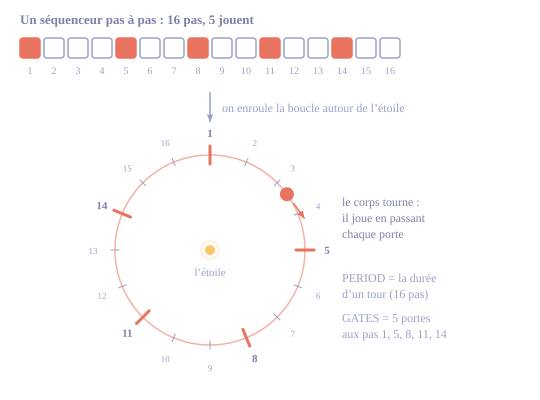
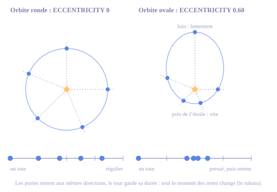
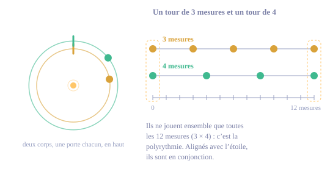

# Rhizome : mode d'emploi

Rhizome est un firmware pour le M-VAVE FM-1, écrit pour **When Day Chokes The Night**. Il fait l'espace et le temps :
- un **séquenceur orbital**, où des corps tournent autour d'une étoile et jouent quand ils passent leurs portes ;
- une **bande** à trois têtes ;
- une **réverbe HALL** ;
- des **grains** (le granulaire de Monades).

Il est complémentaire de Monades (le premier FM-1, qui fait les notes) et joue aussi très bien seul.

> **État au 4 novembre 2026.** Rhizome reprend les moteurs de Monades, plus SIX-OP FM et STRING MACHINE. Cette version se compile et passe ses tests ; **sa charge sur le FM-1 reste à mesurer** avant de l'installer pour de bon (voir « Points de vigilance »).

Rhizome repart du code de **Monades 0.1.3**. Tout ce que Monades sait faire est encore là : voix, filtres, rythmes, phrases, générateurs, gammes, MIDI, sauvegardes. Ce mode d'emploi décrit ce que Rhizome ajoute ou change. Pour les pages héritées, voir le [mode d'emploi de Monades](https://dr-john-8bits.github.io/rhizome/monades/manuel/).

## Où trouver quoi

Les boutons du FM-1 portent les noms du firmware d'origine de M-VAVE. Cinq boutons ouvrent les pages : HOME, EDIT, SEQ, FX, GLO. Appuyer plusieurs fois sur le même bouton fait défiler ses pages. Sur chaque page, les potards K1 à K4 règlent ce que montre le bandeau du bas.

| Je cherche | Appuyer sur | Page |
|---|---|---|
| Les orbites d'une piste | SEQ 1 fois | ORBIT |
| La précession, la perturbation, la source des notes, un système réel | SEQ 2 fois | ORBIT / SYSTEM |
| Les lunes (ornements) | SEQ 3 fois | ORBIT / MOONS |
| La comète, les conjonctions | SEQ 4 fois | ORBIT / COMET |
| Le delay à bande | FX 1 fois | TAPE ECHO |
| La saturation, l'usure, FREEZE, STOP et REWIND de la bande | FX 2 fois | TAPE ECHO / AGE |
| La réverbe | FX 3 fois | HALL |
| Les graves, les aigus, la diffusion, le mode vintage de la réverbe | FX 4 fois | HALL / COLOR |
| Le niveau, la taille, la position et le retour des grains | FX 5 fois | GRANULAR BUS |
| La densité, la forme, le hasard et le média des grains | FX 6 fois | BEADS |
| La hauteur et le sens des grains | FX 7 fois | TAPE / MOTION |
| Le retour commun des effets (bande et réverbe) | FX 8 fois, K4 | SHARED SPACE |
| Ce qu'une piste envoie aux grains, à la bande, à la réverbe | EDIT 5 fois : K2, K3, K4 | GLOBAL MIXER |
| Figer la mémoire des grains | LFO (le bouton) | |
| Le tempo, la gamme, la note de base | GLO 1 fois | HARMONY |

## Les pages, bouton par bouton

| Bouton | Pages, dans l'ordre |
|---|---|
| HOME | LIVE MONDE → MORPH → DERIVE |
| EDIT | SOUND → VELVET FILTER → ENVELOPE → MIX → GLOBAL MIXER |
| SEQ | **ORBIT → ORBIT / SYSTEM → ORBIT / MOONS → ORBIT / COMET** → RHYTHM → GROOVE → BASS / MOTIFS → PHRASE → GENERATOR → FORM |
| FX | **TAPE ECHO → TAPE ECHO / AGE → HALL → HALL / COLOR** → GRANULAR BUS → **BEADS** → TAPE / MOTION → SHARED SPACE → SPACE TONE → ECHO SYNC / CHORUS → MARBLES / TIDES / WARPS → LFO A → LFO B |
| GLO | HARMONY → RAGA / GAMAKA → SYSTEM → LOOK → MIDI → MIDI CHANNELS → MIDI OUT ZONES → USER BANKS |

Les pages en gras sont celles de Rhizome.

Les autres commandes ne changent pas :
- **SELECT** choisit la piste (1 à 6) ;
- **SEL** coupe ou rétablit la piste choisie ;
- **PLAY** lance ou arrête ;
- **ENV** annule ;
- **PRESET** change de Monde ;
- maintenir un bouton de page ouvre l'aide de la page affichée.

Deux différences :
- sur les pages de Rhizome, **REC** ne tire pas la page au sort : il donne une nouvelle variation, comme sur LIVE ;
- le bouton **LFO** fige la mémoire des grains.

## L'accueil : le système du Monde

**LIVE MONDE** (HOME) montre, à gauche, le système orbital du Monde en miniature, tel qu'il joue :
- l'**étoile** au centre, qui brille de ce qu'on entend ;
- l'**ellipse** de chaque piste qui a des portes, dans sa couleur, et ses **portes** en pointillé, qui s'allument en blanc quand le corps les franchit ;
- chaque **corps** là où il est, avec une onde à chaque note ; la piste choisie est cerclée ;
- un trait de l'étoile vers deux corps **en conjonction** ;
- la **comète** quand elle passe dans le cadre ;
- autour, l'**anneau de poussière**, dont la taille et l'éclat suivent **SPACE**.

À droite, les six pistes et leur moteur, avec un vumètre. En bas, les quatre macros :
- **K1 DENSITY** ajoute ou retire des portes à toutes les orbites, comme elle ajoute ou retire des coups à un rythme (jusqu'à cinq portes de chaque côté). Une orbite garde toujours sa période et sa forme ;
- **K2 MOTION**, **K3 COLOUR** et **K4 SPACE** gardent leur rôle de Monades : variation des notes, couleur du son, niveau des grains.

**Au démarrage**, les corps du Monde chargé tombent de loin sur leurs orbites, puis tournent à leurs vraies vitesses (un tour à son tempo). Avec **LOOK** (GLO 4 fois), K1 MOTION choisit si les corps tournent (LIVING) ou restent immobiles (STILL), et K3 rejoue le démarrage.

## Les Mondes

Rhizome a **18 Mondes**, écrits pour When Day Chokes The Night. Les trois premières familles vont du crépuscule à l'aube, et chacune montre une idée du séquenceur orbital. La quatrième, DEEP, fait évoluer la musique sur plusieurs minutes. Le 19e, **EMPTY SKY**, est une page blanche : aucune porte, aucun coup, les effets à zéro.

**Chaque Monde joue quatre voix au plus**, pour rester loin de la limite de 85 % du processeur : la bande, la HALL et les grains en prennent déjà une bonne part. Les sons sont ceux de Monades, avec SIX-OP FM et STRING MACHINE, les deux voix propres à Rhizome, dans les Mondes DEEP (une seule des deux dans les plus chargés). Tous sont réglés au même niveau d'écoute, mesuré sur une minute (sauf NO STARS et LOOPS OF ASH, plus clairsemés, un peu plus bas).

**DUSK, les résonances.** Des orbites rondes ou presque, dont les périodes sont des rapports simples. On entend des polyrythmes lents et réguliers.

| Monde | Gamme · tempo | Ce qu'on entend |
|---|---|---|
| 1 LAST LIGHT | D DORIAN · 64 | Quatre corps en 8:3:4:6 : la basse fait le 8, des cloches et un sinus au-dessus. |
| 2 AMBER HOUR | A MINOR PENT · 72 | Une résonance de Laplace : 1:2:4, comme Io, Europe et Ganymède. Des cloches FM. |
| 3 LONG SHADOWS | F LYDIAN · 60 | Trois corps de cinq portes en 6:7:8 : ils se décalent lentement, puis se retrouvent. |
| 4 SLOW EMBERS | E MINOR · 54 | Tintinnabuli : une flûte joue sa phrase (MOTIF), un sinus lui répond sur l'accord (ECHO). |

**NIGHT, les orbites excentriques.** Le rubato : les corps pressent près de l'étoile et restent suspendus loin d'elle. Les ellipses tournent (précession), certaines portes sautent (perturbation).

| Monde | Gamme · tempo | Ce qu'on entend |
|---|---|---|
| 5 NIGHT SWALLOWS | C PHRYGIAN · 58 | Deux corps très excentriques, des notes qui se précipitent puis attendent. |
| 6 BLACK ORCHARD | G KUMOI · 66 | La perturbation la plus forte : des portes qui respirent et se taisent. Bande usée, grains sales. |
| 7 SLEEPLESS TIDE | D JUST MINOR · 50 | Une marée : les ellipses tournent vite, les notes montent près de l'étoile. |
| 8 NO STARS | B LOCRIAN · 46 | Presque rien. Une comète toutes les 32 mesures fige les grains. |

**DAWN, les lunes et les comètes.** Des ornements après les notes, des passages rares, des accords quand les corps s'alignent.

| Monde | Gamme · tempo | Ce qu'on entend |
|---|---|---|
| 9 FIRST BIRD | G MAJOR PENT · 76 | Des lunes qui montent la gamme et par tierces : des appels d'oiseaux. |
| 10 PALE COMET | E LYDIAN · 62 | Une comète toutes les 16 mesures : la salle gonfle à son passage. |
| 11 CHOKED DAWN | F# DORIAN · 56 | Les conjonctions frappent des accords. Bande saturée et usée, comète qui gonfle et fige. |
| 12 DAY BREAKS | D MIXOLYDIAN · 84 | Une phrase ornée d'harmoniques, des accords aux conjonctions, une comète qui fige les grains. |

**DEEP, les formes longues.** Des Mondes qui ne cessent de changer : LFO lents, générateurs, forme, systèmes réels, gamakas, périodes libres. Chacun en montre quelques-uns, pas tous.

| Monde | Gamme · tempo | Ce qu'on entend |
|---|---|---|
| 13 COLD IN THE DARK | D MINOR · 72 | La vitrine : des boucles de quelques pas, les trois sources de notes, une phrase que son générateur fait muter, des lunes, une nappe en période libre qui ne tombe jamais en place, la précession, une comète, des accords, des LFO lents et la forme. |
| 14 KEPLER NIGHT | A DORIAN · 60 | Le système Kepler-223 tel qu'il a été mesuré (3:4:6:8), une nappe DX7 et un chœur, la couleur de la FM qui tourne avec un LFO lent ; toutes les 16 mesures, une comète dont le FILTER ouvre tout le ciel à son passage. |
| 15 TRAPPIST DUST | E HIRAJOSHI · 66 | La chaîne résonante de TRAPPIST-1 (2:3:4:6), ses notes tirées par des générateurs qui s'en souviennent (déjà-vu), puis les lâchent peu à peu. |
| 16 RAGA OF ASH | D BHAIRAVI · 52 | Un raga de nuit : un bourdon grave, une flûte qui chante sa phrase en meend, une anche qui ondule (andolan), des cloches DX7 avec kan, et les notes pivots. |
| 17 SLOW TIDES | F MIXOLYDIAN · 58 | La forme : calme, montée, sommet, retombée, seize mesures chacun, des pistes qui se taisent et reviennent ; des LFO ouvrent les filtres et déplacent les voix. |
| 18 LOOPS OF ASH | F MINOR · 60 | Quatre périodes libres, une porte chacune : des longueurs des boucles de bande de *Music for Airports* (Brian Eno). Quatre voix qui ne retombent jamais ensemble : la musique ne se répète jamais. |

## Les voix : les 14 moteurs

Chaque piste fabrique son son avec un **moteur**, une méthode de synthèse calculée en direct. Douze sont ceux de Monades ; deux sont propres à Rhizome, **SIX-OP FM** et **STRING MACHINE** (tirés de Plaits), pour les nappes. Chacun va sur chaque piste : **ALGO** le change, **PRESET** (sur la page SOUND) choisit l'un des **256 sons** tout faits : les 224 de Monades, puis 16 pour SIX-OP FM et 16 pour STRING MACHINE.

Dix viennent du code publié par Mutable Instruments (huit de Plaits, un de Rings, un d'Elements). Quatre ont été écrits pour Mutable Dreams.

Sur la page **SOUND** (EDIT 1 fois), K1 à K3 règlent le moteur de la piste choisie et K4 son niveau. Ce que fait chaque potard dépend du moteur ; sur SIX-OP FM et STRING MACHINE, chaque potard porte son nom, et l'écran écrit le nom du son DX7 ou de l'accord choisi.

| Moteur | Ce qu'il fait | K1 TONE | K2 HARMONICS | K3 | Calcul |
|---|---|---|---|---|---|
| PLAITS KICK | Une grosse caisse analogique simulée. | Couleur | Claquement de l'attaque | DECAY : longueur | léger |
| PLAITS SNARE | Une caisse claire : une peau qui résonne et le bruit du timbre. | Couleur | Part du timbre | DECAY : longueur | moyen |
| PLAITS HAT | Une charleston : un son métallique mêlé de bruit. | Couleur | Part du bruit | DECAY : longueur | léger |
| PLAITS FM | Deux ondes dont l'une fait vibrer l'autre : cloches, piano électrique, métal. | Brillance | Rapport des deux ondes (le caractère) | SHAPE : réinjection, vers le grain | moyen |
| PLAITS VA | Deux oscillateurs analogiques simulés, comme sur un synthé classique. | Forme de l'onde carrée | Écart d'accord entre les deux | SHAPE : forme de la dent de scie | léger |
| PLAITS HARMONIC | Synthèse additive : des harmoniques qu'on additionne, comme les tirettes d'un orgue. | L'harmonique mise en avant | Nombre d'harmoniques | SHAPE : groupe large ou pointu | moyen |
| RINGS MODAL | Un objet qui vibre (corde, plaque, cloche), frappé à chaque note. | Brillance | De la corde (harmonieux) à la cloche (inharmonique) | DECAY : amortissement | **lourd** |
| ELEMENTS STRIKE | Un excitateur et un corps qui résonne. | Brillance | Géométrie du corps | EXCITER : maillet, médiator, particules | **lourd** |
| SINE CHOIR | Trois sinus qui chantent un accord, ramené dans la gamme. | Volume des deux voix du haut | L'accord : mineur, majeur, suspendu, quinte et octave | SHAPE : écart d'accord (chœur plus large) | léger |
| ROUND BASS | Une basse ronde en sons purs. | Ajoute l'octave au-dessus | Ajoute l'octave en dessous | sans effet (longueur : page ENVELOPE) | léger |
| MELLOW DRIFT | Deux sons purs qui se désaccordent lentement : un son doux qui flotte. | Harmoniques douces | Ajoute l'octave | SHAPE : ampleur de la dérive | léger |
| SATIN MORPH | Deux oscillateurs qui glissent entre des formes d'onde arrondies. | Du son pur à la forme choisie | Passe d'une forme à la suivante | SHAPE : dérive entre les deux | moyen |
| SIX-OP FM | La synthèse des DX7 : 96 sons d'époque, nappes de verre, cloches, pianos électriques. | BRIGHT : le niveau des modulateurs | SOUND : le son DX7, nommé | ENVELOPE : étire ou resserre ses enveloppes | moyen |
| STRING MACHINE | Des cordes analogiques, comme les Solina des années 70, avec leur effet d'ensemble : la nappe d'ambient par excellence. Il joue un accord. | BRIGHT : filtre et ensemble | CHORD : l'accord, nommé | REGISTER : le mélange des registres | moyen |

- **La colonne « Calcul »** donne l'estimation qui sert à la garde automatique (celle de Monades ; pour SIX-OP FM et STRING MACHINE, la mesure sur le FM-1). Sur le FM-1, chaque voix qui sonne coûte aussi son filtre, son enveloppe et ses envois, environ 6 % : quatre voix ensemble, c'est la bonne mesure. Les Mondes de Rhizome n'utilisent pas d'ELEMENTS et un seul RINGS (dans BLACK ORCHARD). Une voix dont le son s'est éteint se met en veille et ne coûte plus rien jusqu'à sa note suivante.
- **KICK, SNARE, HAT et RINGS** règlent leur longueur avec DECAY ; les autres ont une enveloppe (page **ENVELOPE** : attaque et déclin). SIX-OP FM garde en plus les enveloppes de son DX7.
- **En ECO** (page SYSTEM), FM, VA, HARMONIC, SIX-OP FM et STRING MACHINE sont calculés à mi-cadence pour soulager le processeur : les aigus s'adoucissent un peu. SIX-OP FM garde la durée de ses enveloppes. Les Mondes de Rhizome se chargent en ECO.
- **Un Monde ou une sauvegarde de Monades** se charge tel quel : ce sont les mêmes moteurs. Une sauvegarde d'une version d'essai de Rhizome à huit moteurs de Plaits reçoit, pour chaque piste, le moteur le plus proche d'aujourd'hui.
- **Les batteries ne jouent pas de mélodie** : sur une orbite, elles ignorent la source des notes (ORBIT, MOTIF, ECHO) et leurs lunes répètent le même coup.

Le détail des pages héritées (filtres, enveloppes, LFO, gammes) est dans le [mode d'emploi de Monades](https://dr-john-8bits.github.io/rhizome/monades/manuel/). Dans Rhizome, les cibles de LFO **ECHO** visent la bande, **ROOM** la HALL et **GRAIN** les grains.

## Premiers pas : faire tourner des orbites

1. Écouter un Monde : PRESET, puis PLAY. Pour partir de zéro, aller au Monde 19, **EMPTY SKY**.
2. Appuyer sur **SEQ** : la page **ORBIT** s'ouvre. Tourner **K3 GATES** : la piste choisie devient un corps qui tourne autour de l'étoile, avec autant de portes que le réglage.
3. Avec SELECT, passer à une autre piste et lui donner aussi des portes, avec une autre période (**K1**).
4. Appuyer sur **PLAY**. Tous les corps partent du haut, ensemble.
5. Ovaliser une orbite avec **K2 ECCENTRICITY** : le corps accélère près de l'étoile et ralentit loin d'elle. On entend un rubato qui revient à chaque tour.

Plus rapide encore : **SEQ 2 fois**, puis **K4 SYSTEM**, pour charger un vrai système planétaire (voir plus bas).

## Le séquenceur orbital

### L'idée, en partant d'un séquenceur pas à pas
Un séquenceur pas à pas fait tourner une boucle de pas, et certains pas jouent. Le séquenceur orbital fait la même chose, mais la boucle est **une orbite**, et la piste est **un corps** qui en fait le tour.

| Sur un séquenceur pas à pas | Sur le séquenceur orbital |
|---|---|
| La longueur de la boucle (le nombre de pas) | **PERIOD** (K1) : la durée d'un tour, de 1 temps à 12 mesures, ou libre, en secondes |
| Les pas qui jouent | **GATES** (K3) : de 1 à 16 portes par tour, réparties le plus régulièrement possible |
| Décaler le motif | **PHASE** (K4) : faire tourner les portes |
| Le swing, le même petit retard à chaque contretemps | **ECCENTRICITY** (K2) : le tour garde sa durée, mais les notes se resserrent d'un côté de l'orbite et s'étirent de l'autre |
| Une piste, une boucle | Une piste, un corps. Plusieurs corps aux périodes différentes font une polyrythmie qui se réaligne |

Concrètement :
- **Le nombre de pas d'un tour**, c'est PERIOD. Ses 13 premières valeurs, en doubles croches : 4 (1 temps), 6, 8, 12, 16 (1 mesure), 24, 32, 48, 64, 96, 112, 128 et 192 (12 mesures).
- **Au-delà, les périodes libres** : 5,1 s, 7,3 s, 11,6 s, 17,8 s, 20,1 s, 23,5 s, 29,9 s et 31,8 s, quel que soit le tempo. Aucune ne divise une autre : deux corps libres ne retombent jamais ensemble, et la musique ne se répète pas. Les cinq dernières sont les longueurs des boucles de bande de *Music for Airports* de Brian Eno. Sur une orbite libre, les portes sont placées sur 16 directions.
- **Le nombre de notes par tour**, c'est GATES, de 1 à 16. Il ne peut pas dépasser le nombre de pas du tour : un tour d'un temps compte 4 pas, donc 4 portes au plus. À 0, la piste n'est plus un corps et reprend son rythme de la page RHYTHM.
- **Les portes sont placées comme un rythme euclidien** : réparties le plus régulièrement possible sur les pas du tour. Par exemple, 5 portes sur un tour d'une mesure (16 pas) tombent sur les pas 1, 5, 8, 11 et 14 : c'est le rythme euclidien 5 sur 16. Avec 4 portes, on obtient quatre noires.

### L'étoile
L'étoile ne joue pas. C'est le centre de gravité : **tout se mesure par rapport à elle**.
- **Les corps tournent autour d'elle.** Sur une orbite ovale, un corps va plus vite près de l'étoile et plus lentement loin d'elle (la deuxième loi de Kepler). D'où le rubato.
- **Les portes sont des directions vues depuis l'étoile**, comme les heures d'un cadran : un corps joue quand il passe devant l'une d'elles.
- **La distance à l'étoile peut donner la note.** Avec la source ORBIT, plus le corps est près, plus la note est aiguë.
- **Les événements se passent par rapport à elle.** Une conjonction, c'est deux corps alignés avec l'étoile ; la comète agit en la frôlant.
- **À l'écran, elle brille** avec le niveau de sortie.

### Rond, puis ovale
- **Une orbite ronde** : le corps tourne à vitesse constante et passe ses portes à intervalles réguliers. C'est exactement le rythme euclidien.
- **Une orbite ovale** : il passe toujours le même nombre de portes en un tour de la même durée, donc la boucle reste calée sur la mesure. Mais il les passe vite du côté de l'étoile et lentement de l'autre. Les notes se resserrent puis s'espacent, comme un musicien qui presse puis retient : un rubato qui revient à chaque tour.

- **Avec la précession**, l'ovale tourne lentement sur lui-même. Le moment où les notes se resserrent glisse alors peu à peu par rapport à la mesure, et la phrase change sans hasard.

### Plusieurs corps
Chaque piste a sa propre orbite. Avec des périodes différentes, les corps se retrouvent tous les N tours.

 Par exemple, un tour de 3 mesures et un tour de 4 mesures se réalignent toutes les 12 mesures. Ce sont les rapports que montre la carte de PERIOD (par exemple 3:4:6:8), et c'est le principe des systèmes réels de K4 SYSTEM.

Le mouvement suit le tempo, le swing et l'horloge MIDI reçue. PLAY fait repartir tous les corps du haut.

### Ce que montre l'écran
- **Les ellipses** : leur vraie forme et leur vraie orientation. Celle de la piste choisie est plus vive ; une piste sans porte est en pointillé.
- **Les portes** : de petits traits sur les ellipses. Une porte devient blanche quand elle joue, et grise quand la perturbation l'a refusée.
- **Les corps et leurs traînées** : **la longueur de la traînée est la vitesse**, donc on voit le rubato.
- **Une onde** autour du corps à chaque note.
- **L'anneau extérieur** : la mesure, avec un point sur le temps en cours.
- **Un trait blanc** depuis l'étoile quand deux corps s'alignent (une conjonction).
- **Un pointillé** entre deux corps quand l'un fait écho à l'autre (ÉCHO).
- **L'étoile** brille avec le niveau de sortie.

Quand on tourne un potard, une carte apparaît sur la moitié de l'écran où le corps n'est pas : le nom du réglage, sa valeur et ce qu'il fait.

### ORBIT (piste choisie)
| Potard | Réglage | Ce qu'il fait |
|---|---|---|
| K1 | PERIOD | La durée d'un tour : de 1 temps à 12 mesures, en 13 valeurs, puis 8 périodes libres en secondes (FREE). La carte donne les rapports des orbites qui suivent le tempo, par exemple 3:4:6:8. |
| K2 | ECCENTRICITY | De rond (0) à très ovale (0,85). La carte dit combien de fois plus vite le corps va près de l'étoile. |
| K3 | GATES | Le nombre de portes par tour, de 0 (orbite coupée) à 16. |
| K4 | PHASE | Fait tourner les portes par pas de 15°. |

### ORBIT / SYSTEM
| Potard | Réglage | Ce qu'il fait |
|---|---|---|
| K1 | PRECESSION | Toutes les ellipses tournent lentement sur elles-mêmes. Le rubato glisse alors par rapport à la mesure, et la phrase change sans hasard. 100 = un tour en 16 mesures. |
| K2 | PERTURBATION | Le système vit : les orbites respirent, des portes sont refusées, des notes voisines s'invitent. 0 = une horloge parfaite. |
| K3 | PITCH | D'où viennent les notes de la piste choisie (voir ci-dessous). |
| K4 | SYSTEM | Charge un système planétaire réel, ou affiche OWN pour vos propres orbites. |

**Les trois sources de notes (K3 PITCH)** :
- **ORBIT** : plus le corps est près de l'étoile, plus la note est aiguë. L'ellipse dessine donc une mélodie qui monte et descend, dans la gamme choisie sur HARMONY.
- **MOTIF** : le corps joue, porte après porte, les notes écrites au clavier sur la page GENERATOR (comme le MOTIF de Monades). **Sur la page ORBIT, chaque porte que le corps va franchir affiche la note qu'elle jouera**, la prochaine en blanc.
- **Les générateurs** (page GENERATOR) agissent aussi sur un corps : avec ORBIT ou MOTIF, chaque note reçoit le décalage du générateur de la piste (hasard, Markov ou motif qui mute), avec sa mémoire déjà-vu. Et **MOTION** fait sauter une part des notes, comme sur un rythme.
- **ECHO** : le corps reprend la dernière note de la piste précédente, ramenée à la note de l'accord de la tonique juste au-dessus (l'idée du tintinnabuli d'Arvo Pärt).

**Les systèmes réels (K4 SYSTEM)** : leurs périodes et excentricités sont mesurées, ramenées aux valeurs les plus proches du séquenceur sans changer les rapports. Chaque corps a 4 portes, donc les rapports s'entendent comme une polyrythmie.

| Système | Corps | Rapports |
|---|---|---|
| JUPITER | Io, Europe, Ganymède, Callisto | 1:2:4, puis 9,3 |
| KEPLER-223 | quatre planètes | 3:4:6:8 |
| TRAPPIST-1 | les planètes e, f, g, h | 2:3:4:6 |
| PLUTO | Neptune, Pluton (et Charon, sa lune) | 3 tours contre 2 |

Comment ça se charge :
- les corps vont d'abord sur les pistes mélodiques non coupées ;
- le son, la gamme, la comète et les conjonctions ne changent pas ;
- dès qu'on touche une orbite, le système redevient OWN ;
- **ENV** revient aux orbites d'avant le premier système chargé.

### ORBIT / MOONS (piste choisie) : les lunes
Chaque note du corps fait faire un tour à ses lunes autour de lui. Une lune joue un ornement quand elle passe du côté du corps opposé à l'étoile. Au repos, les lunes attendent régulièrement espacées, donc les ornements partagent le tour en parts égales après la note.

| Potard | Réglage | Ce qu'il fait |
|---|---|---|
| K1 | MOONS | De 0 à 3 lunes. |
| K2 | SPIN | Le temps d'un tour, de 1/16 à une mesure. La carte dit l'écart entre deux ornements. |
| K3 | INTERVAL | Ce que jouent les lunes : REPEAT (la même note), STEPS UP ou DOWN (la gamme note par note), THIRDS UP ou DOWN (par tierces), HARMONICS (l'octave, l'octave et la quinte, deux octaves). Sur une piste de batterie, la lune rejoue le même coup. |
| K4 | LEVEL | Le volume des lunes, en pourcentage de celui de la note. |

Sur cette page, le corps choisi est **en gros plan** : l'étoile est en bas, le point où les lunes jouent est marqué en haut, et chaque lune porte le nom de la note qu'elle jouera. Sur les autres pages, les lunes sont de petits points autour des corps.

Bon à savoir : les ornements partent aussi en MIDI, et l'ÉCHO reprend la note du corps, pas ses ornements.

### ORBIT / COMET (tout le système) : la comète et les conjonctions
La **comète** est un corps sans voix, sur une orbite très allongée. Elle passe presque tout son tour loin de l'étoile, puis la frôle. PLAY la fait partir de loin, donc son premier passage arrive à la moitié du tour. Son passage agit pendant à peu près un cinquième du tour, le plus fort au plus près de l'étoile.

| Potard | Réglage | Ce qu'il fait |
|---|---|---|
| K1 | COMET | Un tour en 4, 8, 16, 32 ou 64 mesures, ou OFF. La carte dit dans combien de mesures elle repassera. Tout en haut, **WANDER** : la comète vagabonde (voir ci-dessous). |
| K2 | EVENT | SWELL (la réverbe gonfle : envoi plus fort, queue plus longue, retour plus fort), FREEZE (la mémoire des grains se fige au cœur du passage), BOTH (les deux) ou **FILTER** : un filtre sur tout le son, fermé tant que la comète est loin, qui s'ouvre à mesure qu'elle approche et en grand quand elle frôle l'étoile, puis se referme. L'écran affiche sa fréquence. |
| K3 | AMOUNT | La force du passage ; avec FILTER, jusqu’où le filtre se ferme quand la comète est loin (jusqu’à 280 Hz à 100). |
| K4 | CONJUNCTION | Ce que fait l'alignement de deux corps avec l'étoile : OFF (rien), ACCENT (leur temps suivant est accentué) ou CHORD (les deux rejouent ensemble ; le second prend la note de l'accord du premier la plus proche de la sienne). |

**La comète vagabonde (WANDER).** Elle revient au hasard, toutes les 4 à 32 mesures, et à chaque passage elle **choque** le corps le plus proche de sa trajectoire. Pendant quelques-unes de ses notes, ce corps :
- **saute une note** (un trou là où on l'attendait) ;
- ou **est poussé d'un pas** : sa porte suivante arrive en avance ;
- ou **joue ses notes un ou deux degrés plus haut ou plus bas**, toujours dans la gamme.

Le choc peut passer au corps voisin, puis au suivant, chaque fois deux fois moins probable : une petite réaction en chaîne. **K3 AMOUNT** règle la violence : combien de notes sont touchées (une à cinq) et la probabilité de la chaîne (60 % à 100). **Chaque choc secoue aussi les effets** : la HALL gonfle et la bande trébuche (elle ralentit puis repart, les échos plongent), pendant environ une seconde et demie, d'autant plus fort que AMOUNT est haut. **K2 EVENT** agit en plus à son passage (la salle, les grains, le filtre). Tout est **temporaire** : rien n'est écrit dans le Monde, et les orbites retrouvent leurs réglages. Avec LOCK, le même Monde rejoue les mêmes chocs. À l'écran, un corps choqué est entouré d'un cercle en pointillé qui tourne, un trait par note encore touchée ; la carte de K1 compte les chocs.

À l'écran :
- **la queue de la comète pointe à l'opposé de l'étoile**, et sa longueur montre la force du passage ;
- quand la comète est hors de l'écran, une marque sur l'anneau suit sa direction et s'éclaire à son approche.

## La bande : TAPE ECHO

Le delay est une boucle de bande qui défile sous une tête d'enregistrement et trois têtes de lecture, placées à 1/3, 2/3 et au bout du trajet. **TIME règle la vitesse de la bande**, pour que la tête la plus lointaine en service réponde après ce temps :
- **bande rapide** (jusqu'à 12 fois plus vite) : échos courts et nets ;
- **bande lente** (jusqu'à moitié moins vite) : échos longs, plus sombres et plus granuleux, jusqu'à 2,86 s.

La vitesse a de l'inertie : changer le temps fait glisser la hauteur, comme sur une vraie machine.

### TAPE ECHO
| Potard | Réglage | Ce qu'il fait |
|---|---|---|
| K1 | TIME | Le temps de la tête la plus lointaine en service. Si l'écho est synchronisé au tempo (page ECHO SYNC / CHORUS, K1), K1 choisit la division. |
| K2 | FEEDBACK | Combien de fois l'écho se répète. |
| K3 | HEADS | Les têtes en service : 1, 2, 3 ou leurs combinaisons. |
| K4 | WOW | Le wow, le flutter et la dérive de la vitesse. |

### TAPE ECHO / AGE
| Potard | Réglage | Ce qu'il fait |
|---|---|---|
| K1 | DRIVE | La saturation de la tête d'enregistrement. |
| K2 | AGE | L'usure : souffle (seulement sous ce qui est enregistré), aigus perdus, chutes de niveau. |
| K3 | TONE | Chaque répétition un peu plus sombre, ou beaucoup. |
| K4 | TRANSPORT | RUN, **FREEZE** (la tête d'enregistrement se lève, la boucle se répète), **STOP** (la bande freine et le son plonge ; RUN la relance) ou **REWIND** (la tête se lève et la bande repart en arrière, trois fois plus vite : les échos reviennent à l'envers, plus aigus ; RUN la remet dans le bon sens). |

À l'écran :
- les **bobines** tournent à la vitesse de la bande, ralenties à l'affichage pour que les rayons ne semblent jamais tourner à l'envers ;
- le **bras tendeur** bouge avec le wow ;
- **ce que la tête d'enregistrement écrit est dessiné sur la bande et avance vers les têtes de lecture** : on voit l'écho arriver avant de l'entendre ;
- chaque tête en service affiche son temps et devient blanche quand elle rejoue ;
- sous FREEZE et REWIND, la tête d'enregistrement se lève ; en REWIND, les bobines tournent à l'envers.

## La réverbe : HALL

Une réverbe de la famille des grandes réverbes « hall » numériques, celle dont le Lexicon 224 est issu. Elle reprend les longueurs de la réverbe de Rings et Clouds de Mutable Instruments.

### HALL
| Potard | Réglage | Ce qu'il fait |
|---|---|---|
| K1 | DECAY | Le temps pour perdre 60 dB, de 0,5 à 20 s, puis **INFINITE** : la queue tient et plus rien n'entre, comme une nappe figée. |
| K2 | SIZE | La taille de la salle (la carte donne la durée d'un tour de la boucle). |
| K3 | PRE-DELAY | Le temps avant que la salle réponde, de 0 à 250 ms. |
| K4 | MOD | Un lent chatoiement dans la queue. |

### HALL / COLOR
| Potard | Réglage | Ce qu'il fait |
|---|---|---|
| K1 | BASS | Les graves durent de 0,5 à 2 fois plus longtemps que les médiums. |
| K2 | TREBLE | Plus bas, les aigus s'éteignent plus vite. |
| K3 | DIFFUSION | Des échos plus distincts au début de la queue, ou un début plus doux et plus dense. |
| K4 | VINTAGE | La réverbe tourne à 22 kHz, comme les réverbes numériques d'époque : plus sombre, deux fois plus grande, deux fois moins de calcul. |

À l'écran :
- **trois droites** montrent en combien de temps les graves, les médiums et les aigus perdent 60 dB après le pré-délai. En INFINITE, elles sont plates ;
- **sur chaque droite, un point** donne l'énergie réelle de la queue dans cette bande, et glisse le long de la droite à mesure que le son s'éteint.

Les réglages DECAY, TREBLE et DIFFUSION sont aussi sur les pages SHARED SPACE et SPACE TONE, héritées de Monades.

### Entendre la HALL
Une réverbe s'entend surtout **dans ce qui reste après la note**, et la HALL arrive par un envoi et un retour. Elle reste donc muette tant que l'un des deux est bas. Dans les Mondes d'usine, elle arrive 9 à 18 dB sous le reste du son : nette sur les nappes et les cloches, absente de la basse, qu'on garde sèche pour un grave net.

**Où la doser** : piste par piste, sur **GLOBAL MIXER** (EDIT 5 fois), **K4**, pour la piste choisie avec SELECT. C'est le réglage de tous les jours. Le niveau d'ensemble de la salle, lui, est **K4 RETURN sur SHARED SPACE** (FX 8 fois), partagé avec la bande.

**Pour l'entendre seule**, depuis n'importe quel Monde :
1. **Couper les grains** : LIVE (HOME), K4 SPACE à 0.
2. **Garder une seule piste** : choisir une piste aux notes courtes (une cloche, un pincé), pas une nappe qui tient. Couper les autres une à une : SELECT pour aller sur chacune, puis SEL.
3. **L'envoyer à la HALL et pas à la bande** : EDIT 5 fois (GLOBAL MIXER), K4 vers la réverbe à 100, K3 vers la bande à 0.
4. **Ouvrir le retour** : FX 8 fois (SHARED SPACE), K4 RETURN à 100. Ce retour sert aussi à la bande, coupée ici par son envoi.
5. **PLAY, puis PLAY de nouveau pour arrêter** : la séquence s'arrête. Une fois la dernière note éteinte, ce qu'on entend encore, c'est la salle seule.

**Puis, sur la page HALL (FX 3 fois), un réglage à la fois** :
- **K1 DECAY** : à 30, une pièce ; vers 60, une grande salle (4 à 6 s) ; tout en haut, INFINITE : la queue ne s'éteint plus.
- **K3 PRE-DELAY** vers 100 ms : la note sèche d'abord, puis la salle qui répond. C'est le réglage qui fait le mieux entendre où commence la réverbe.
- **K2 SIZE** : petite, la queue grésille un peu (on entend la boucle) ; grande, elle devient lisse.
- **K4 MOD** : sur une note tenue, un léger chatoiement, comme un chorus dans la queue. À 0, la queue est plus fixe et plus métallique.
- **Sur HALL / COLOR** : BASS en haut, les graves traînent (une salle de pierre) ; TREBLE en bas, la queue s'assombrit vite (une salle de bois) ; VINTAGE, plus sombre et deux fois plus grande.

**L'écran aide** : si les points ne montent pas sur les trois droites, rien n'entre dans la salle. En haut de la page, « RETURN AT 0 » ou « NO SEND » dit ce qui manque.

**Dans un morceau**, la HALL se règle surtout par piste : une nappe ou une cloche bien envoyées (K4 à 60–100), une basse peu ou pas envoyée, pour garder le grave net.

## Les grains

Le granulaire est celui de Monades : jusqu'à quatre grains qui relisent une bande de 128 Ko, chacun dans une fenêtre. Il remplace Beads de Mutable Instruments, qui prenait à lui seul plus de la moitié du processeur du FM-1 dès que du son le traversait (mesuré le 4 novembre 2026). La page garde le nom BEADS et les mêmes réglages. Les pistes y envoient du son (GLOBAL MIXER, K2), et SPACE règle le niveau des grains (LIVE K4, ou GRANULAR BUS K1). **Quand SPACE est à 0, Beads se repose et ne calcule rien.**

### GRANULAR BUS
| Potard | Réglage | Ce qu'il fait |
|---|---|---|
| K1 | SPACE | Le niveau des grains. |
| K2 | GRAIN SIZE | La longueur des grains. |
| K3 | POSITION | Où, dans la mémoire, naissent les nouveaux grains. |
| K4 | FEEDBACK | Les grains réinjectés dans la mémoire. |

### BEADS
| Potard | Réglage | Ce qu'il fait |
|---|---|---|
| K1 | DENSITY | **Au milieu, aucun grain.** À gauche, des grains réguliers, de plus en plus fréquents. À droite, des grains au hasard, de plus en plus nombreux. La carte donne le nombre de grains par seconde. |
| K2 | SHAPE | L'enveloppe de chaque grain : carrée, puis décroissante, puis en cloche, puis inversée. Elle est dessinée à l'écran. |
| K3 | RANDOM | Fait varier la position, la taille, la forme et la hauteur d'un grain à l'autre. |
| K4 | MEDIA | Le grain de la mémoire et sa durée : DIGITAL (16 bits, 1,5 s), CLEAN TAPE (à demi-fréquence, plus doux, 3 s), DIRTY TAPE (à demi-fréquence, en marches grossières et avec une lente ondulation, 3 s). **Changer de média vide la mémoire.** |

### TAPE / MOTION
- **K1 PITCH** : la hauteur des grains, de −24 à +24 demi-tons.
- **K2 DIRECTION** : à l'endroit, ou à l'envers (les grains sont alors lus à rebours).

### Ce que montrent GRANULAR BUS et BEADS
- La mémoire, avec le présent à droite et toute sa durée vers la gauche.
- Le niveau écrit le long de la mémoire.
- Chaque grain vivant, sous forme d'une bande qui part de l'endroit où il lit, avec un trait blanc à ce point.
- Le crochet de POSITION, et sous lui le trait du feedback.

Le bouton **LFO** fige la mémoire, et la comète peut la figer à son passage.

## Le trajet du son : envois et retours

- Chaque piste envoie une part de son son vers trois destinations, réglées sur **GLOBAL MIXER** (EDIT 5 fois) : **K2** vers les grains, **K3** vers la bande, **K4** vers la réverbe.
- Le niveau des grains est **SPACE**. Celui de la bande et de la réverbe est le retour commun, **K4 RETURN sur SHARED SPACE**.
- Quand on n'entend pas un effet, sa page le dit en haut de l'écran, par exemple « RETURN AT 0 » ou « NO SEND ».

## Recettes

- **Une nappe qui ne finit pas** : HALL K1 DECAY tout en haut (INFINITE) au moment voulu. La queue tient, le reste continue par-dessus. On redescend DECAY pour la relâcher.
- **Un écho qui devient une bande lointaine** : TAPE ECHO, K3 HEADS sur 1+2+3, K1 TIME vers 2 s (la bande ralentit et s'assombrit), K2 FEEDBACK vers 60, puis AGE à 30 et DRIVE à 30.
- **Le geste de la bande qui s'arrête** : TAPE ECHO / AGE, K4 sur STOP en fin de phrase, puis RUN.
- **Un retour en arrière** : après une phrase dans la bande (K3 HEADS sur 1+2+3, FEEDBACK vers 50), K4 sur REWIND quelques secondes : les échos remontent à l'envers ; puis RUN.
- **Une musique qui ne se répète jamais** : deux ou trois pistes en périodes libres (PERIOD au-delà de 12 mesures), une porte chacune, des notes longues.
- **Un ciel qui tourne lentement** : SEQ 2 fois, K4 SYSTEM sur KEPLER-223, puis PRECESSION à 20 et PERTURBATION à 10.
- **Un rare événement** : SEQ 4 fois, COMET sur 16 mesures, EVENT sur BOTH. Toutes les 16 mesures, la salle gonfle et les grains se figent au passage.
- **Des grains qui scintillent au-dessus** : TAPE / MOTION K1 PITCH à +12, BEADS K1 DENSITY vers 85, K2 SHAPE en cloche, K4 MEDIA sur CLEAN TAPE.
- **Des ornements en harmoniques** : ORBIT / MOONS, 2 lunes, SPIN 1/4, INTERVAL sur HARMONICS, LEVEL à 50.

## Le simulateur

Le simulateur fait tourner le vrai firmware de Rhizome dans le navigateur, avec l'écran du FM-1, ses boutons, ses potards et son clavier. Les sauvegardes du navigateur sont séparées de celles d'un FM-1.

- **Souris** : cliquer sur un bouton ; faire glisser un potard vers le haut ou le bas, ou utiliser la molette.
- **Clavier de l'ordinateur** : les touches Q W E R T Y U I et A S D F G H J K jouent les touches blanches ; 1 à 0 et le tiret jouent les noires. P = PLAY, O = REC, Échap = HOME, Z et X = OCT− et OCT+.
- **Tenir un bouton** (pour ouvrir l'aide d'une page) : Maj-clic ou clic droit le garde enfoncé jusqu'au clic suivant.

## Points de vigilance

- **La charge du processeur.** Comme pour Monades, **la limite de 85 % ne doit jamais être atteinte**, même dans le pire cas. Sur le FM-1, la bande et la HALL prennent ensemble 20 à 25 %, les grains 5 à 12 %, et chaque voix qui sonne son moteur plus environ 6 % pour son filtre, son enveloppe et ses envois : c'est pourquoi les Mondes jouent quatre voix au plus. Un Monde fait à la main peut être plus lourd : six voix toutes jouées, avec la bande, la HALL et les grains grands ouverts, par exemple. La garde automatique passe alors en ECO avant de jouer.
- **Si la charge ne tient pas, Rhizome renoncera à un effet plutôt que de risquer le FM-1.** La première candidate est la HALL : sa mémoire et son calcul serviraient à enrichir le delay ou à un effet plus léger.
- En cas de surcharge, le firmware passe déjà de lui-même en mode économie, et la HALL en VINTAGE.

## Glossaire

| Mot | Ce que c'est |
|---|---|
| **Corps** | Une piste qui a des portes : elle tourne sur son orbite et joue en passant ses portes. Voir [le séquenceur orbital](#le-séquenceur-orbital). |
| **Étoile** | Le centre autour duquel tournent les corps. Elle ne joue pas ; tout se mesure par rapport à elle. |
| **Orbite** | Le chemin d'un corps : un cercle, ou un ovale (une ellipse) dont l'étoile n'occupe pas le centre mais un foyer. |
| **Période** (PERIOD) | La durée d'un tour, de 1 temps à 12 mesures. C'est la longueur de la boucle. |
| **Période libre** | Une période en secondes, qui ne suit pas le tempo (5,1 à 31,8 s). Deux périodes libres ne retombent jamais ensemble. |
| **Porte** (GATES) | Une direction, vue de l'étoile, où le corps joue en passant. Les portes d'un corps sont réparties comme un rythme euclidien. |
| **Rythme euclidien** | N coups répartis le plus régulièrement possible sur un nombre de pas : 5 sur 16 donne les pas 1, 5, 8, 11, 14. |
| **Phase** (PHASE) | Fait tourner toutes les portes d'un corps : décale son motif. |
| **Excentricité** (ECCENTRICITY) | À quel point l'orbite est ovale. 0 : rond, notes régulières ; plus haut : notes pressées près de l'étoile, retenues loin d'elle. |
| **Rubato** | Presser puis retenir le temps, comme un musicien. Ici, c'est l'excentricité qui le donne, de la même façon à chaque tour. |
| **Précession** | L'ovale tourne lentement sur lui-même : le moment où les notes se pressent glisse peu à peu dans la mesure. |
| **Perturbation** | Un peu de désordre : des portes qui sautent, des notes voisines, une orbite qui respire. |
| **Conjonction** | Deux corps alignés avec l'étoile. Selon le réglage, rien, un accent, ou un accord. |
| **Polyrythmie** | Plusieurs boucles de longueurs différentes en même temps ; elles ne se retrouvent qu'après un certain nombre de tours. |
| **Lune** | Un petit satellite d'un corps : après chaque note, elle tourne autour de lui et joue un ornement en passant. |
| **Comète** | Un objet très ovale, qui passe rarement près de l'étoile ; à son passage, la salle gonfle ou les grains se figent. |
| **LFO** | Un mouvement lent et régulier (ou au hasard) qui fait varier un réglage tout seul : la couleur d'un son, un filtre, le panoramique. Deux par piste (pages LFO A et LFO B). |
| **Générateur** | Fabrique les notes d'une piste : au hasard, en suivant les probabilités de la phrase (Markov), ou en faisant muter la phrase. Il se souvient de ce qu'il a joué (déjà-vu) et peut le rejouer. Page GENERATOR ; il agit aussi sur un corps. |
| **Forme** | Une grande respiration : calme, montée, sommet, retombée, quelques mesures chacun ; des pistes se taisent et reviennent. Page FORM. |
| **Gamaka** | Un ornement de la musique indienne autour d'une note : kan (une note frôlée avant), meend (un glissé depuis la note d'avant), andolan (une lente oscillation). Page RAGA / GAMAKA. |
| **REWIND** | La bande qui repart en arrière : les échos reviennent à l'envers. |
| **Comète vagabonde** | WANDER : une comète qui revient au hasard et, en passant, bouscule les corps : notes sautées, avancées ou déplacées dans la gamme, parfois en chaîne. Temporaire. |
| **ORBIT, MOTIF, ECHO** | D'où viennent les notes d'un corps : de sa distance à l'étoile, d'une phrase jouée dans l'ordre, ou de l'accord au-dessus de la piste précédente. |
| **Tintinnabuli** | Une voix qui répond à une mélodie par les notes de l'accord (la manière d'Arvo Pärt) : c'est ECHO. |
| **Système réel** | Les périodes et les formes d'orbites de vraies planètes (Jupiter, Kepler-223, TRAPPIST-1, Pluton), chargées sur les pistes. |
| **Monde** | Un réglage complet du FM-1 : sons, orbites, effets, tempo, gamme. PRESET passe de l'un à l'autre. |
| **Macro** | Les quatre potards de l'accueil, qui agissent sur tout le Monde : DENSITY, MOTION, COLOUR, SPACE. |
| **Moteur** | La méthode de synthèse d'une piste (ALGO). Voir [les 8 moteurs](#les-voix-les-8-moteurs). |
| **Envoi** | La part du son d'une piste qui part vers un effet (GLOBAL MIXER). |
| **Retour** | Le niveau auquel l'effet revient dans le mélange (SHARED SPACE K4 pour la bande et la HALL, SPACE pour les grains). |
| **Têtes** | Les points de lecture de la bande : chacune rejoue ce qui a été enregistré, plus ou moins tard. |
| **Pré-délai** | Le silence entre la note et le début de la réverbe. |
| **RT60** | Le temps qu'il faut à une réverbe pour baisser de 60 dB : sa longueur. C'est DECAY. |
| **Grain** | Un court morceau de son relu dans la mémoire des grains. |
| **Média** | Le grain de la mémoire des grains : DIGITAL, CLEAN TAPE, DIRTY TAPE. |
| **ECO, FULL** | Deux qualités de calcul : ECO soulage le processeur, FULL calcule tout à pleine cadence. |

## Crédits

- **Rhizome** et **Monades** : Dr-John-8bits.
- **Mutable Dreams** : Kid Bunka / Christoph Link.
- **Mutable Instruments** : Émilie Gillet (Plaits, Rings, Elements, Clouds, Beads, stmlib, sous licence MIT).
- **fm1-base** : Charles Vestal. **Felucca / felucca-bsp** : Leo Kuroshita.

Distribution sous GPL-3.0-only. Projet indépendant, sans lien avec Mutable Instruments, M-VAVE ni l'auteur de Mutable Dreams.
